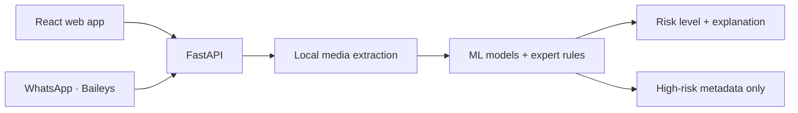

<div align="center">

# 🛡️ Nigehbaan AI

### Explainable scam and abusive-message detection for Roman Urdu

Local-first analysis for text, links, images, PDFs, voice notes, and video — with a React
dashboard and an optional WhatsApp bridge.

<p>
  
  
  
  
  
</p>

<p>
  <a href="docs/TECH_DOC.md">Technical design</a> ·
  <a href="docs/DEMO.md">Demo guide</a> ·
  <a href="docs/MEDIA.md">Media setup</a> ·
  <a href="docs/HANDOFF.md">Project handoff</a>
</p>

</div>

> **Course project:** CT-361 Artificial Intelligence & Expert Systems, NED University.
> Models are experimental; results are not a guarantee of real-world safety.

## What it does

Nigehbaan combines trained text/URL models with an explainable rule-based expert system.
Files are converted to text locally, then use the same analysis pipeline.

| Input | Local processing |
| --- | --- |
| Text and URLs | Roman Urdu preprocessing, ML models, and expert rules |
| Images and scanned PDFs | EasyOCR; text PDFs use PyMuPDF |
| Audio and voice notes | FFmpeg plus faster-whisper |
| Video | Sampled OCR frames plus audio transcription |
| WhatsApp messages and media | Baileys bridge forwards events to the FastAPI backend |

**Gemini is not required.** Inference runs locally. OCR and speech model weights must be
installed once on each machine; they are not committed to the repository. See
[Media setup](docs/MEDIA.md).



## Quick start · Windows demo

From the repository root:

```powershell
powershell -File scripts/start-demo.ps1
```

Open [http://localhost:5173/#/analyze](http://localhost:5173/#/analyze). The launcher reuses
ready local services, opens new processes hidden, and disables API access logging. It does
not train models or download weights. If a port is already in use, resolve that conflict
rather than stopping an unknown process.

## Fresh setup

Requirements: Python 3.11 and Node.js 22 or newer.

```powershell
# Backend
cd backend
python -m venv .venv
.venv/Scripts/python.exe -m pip install torch torchvision --index-url https://download.pytorch.org/whl/cpu
.venv/Scripts/python.exe -m pip install -r requirements.txt

# Install optional local OCR and speech weights for all media types
.venv/Scripts/python.exe -m ml.setup_media --ocr
.venv/Scripts/python.exe -m ml.setup_media --speech

# Frontend
cd ../frontend
npm ci
npm run gen:types
```

The speech model download is about 484 MB. Setup downloads official model files into the
ignored `backend/models/media/` cache; uploaded files are never sent to a model provider.
The `requirements.txt` PyAV version bound is needed for faster-whisper compatibility.

Text and URL model artifacts are also local and uncommitted. For an existing demo, place
trusted `text_clf.joblib` and `url_clf.joblib` files and their matching `.manifest.json`
files in `backend/models/`. The matching ignored synthetic draft is required to reconstruct
the exact text partitions. Missing inference models return `503`; no placeholder prediction
is substituted.

## Run manually

Start the backend from `backend/`:

```powershell
.venv/Scripts/python.exe -m uvicorn app.main:app --host 127.0.0.1 --port 8000 --no-access-log
```

Start the frontend from `frontend/` in another terminal:

```powershell
npm run dev
```

API schema: [http://localhost:8000/docs](http://localhost:8000/docs).

## Verify

```powershell
# From backend/
.venv/Scripts/python.exe -m pytest -q
.venv/Scripts/python.exe -m ml.smoke_media

# From frontend/
npm test
npm run typecheck
npm run lint
npm run build
```

The media smoke script uses synthetic fixtures and reports only aggregate metadata. It tests
integration, not OCR, transcription, or scam-detection accuracy.

## Privacy and honest limitations

- Message text, transcripts, filenames, URLs, and phone numbers are not stored in history or
  written to logs. History contains high-risk metadata only.
- Submitted URLs are analyzed statically and are never visited.
- Temporary uploads and converted media are deleted after processing, including failures.
- WhatsApp alerts default to dry-run. Live pairing and alert delivery require a dedicated
  account and the recipient's informed agreement; live transport has not been verified.
- OCR and speech can miss content. Roman Urdu coverage and model quality are limited.

## Project documents

- [Technical documentation](docs/TECH_DOC.md)
- [Setup and troubleshooting](SETUP-WINDOWS.md)
- [Media setup and limits](docs/MEDIA.md)
- [CCP report](report/Nigehbaan_AI_CCP_Report.md)
