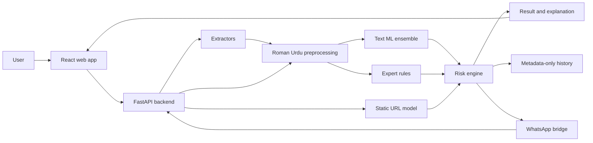

# Nigehbaan AI Project Explanation

## Purpose of this document

This document explains Nigehbaan AI from the beginning. It is written for a reader who may know very little about machine learning, expert systems, web applications, or WhatsApp integrations. It explains what problem the project solves, why each technology was selected, how the parts communicate, how the models were trained, what the user sees, and how to explain the system during a CT-361 viva.

## 1. What the project does

Nigehbaan AI is a privacy-aware system for detecting scam, phishing, and abusive messages written in Roman Urdu or mixed Roman Urdu and English.

The user can provide:

- typed message text;
- a URL;
- an image or screenshot;
- a PDF;
- an audio voice note; or
- a short video.

The system returns:

- a class: `normal`, `abusive`, or `scam`;
- class probabilities;
- a risk score from 0 to 1;
- a risk level: `low`, `medium`, or `high`;
- expert-rule identifiers that matched;
- a human-readable explanation;
- static URL findings when links are present; and
- extraction warnings for media inputs.

It is a decision-support tool. It warns a human; it does not delete messages, block accounts, or claim that a low-risk message is guaranteed safe.

## 2. Why this problem matters

Fraudulent messages commonly pretend to come from a bank, courier, government program, family member, job provider, or payment service. They may request an OTP, PIN, CNIC, password, or money. In Pakistan, these messages are often written in Roman Urdu, where one word can have many spellings, for example `nahi`, `nahin`, and `nhi`.

An English-only spam filter may miss these spelling variations. An Arabic-script Urdu model may not understand Latin-script Roman Urdu. Nigehbaan combines learned patterns with explicit safety rules so that it can both generalize from examples and explain important warning signs.

## 3. The complete system in one sentence

The system extracts text, normalizes it, runs a trained text model, fires expert rules, analyzes URLs using static features, combines the evidence into a risk score, and displays the result in a React web application or sends a privacy-safe WhatsApp alert.

## 4. High-level architecture



The FastAPI backend is the single source of truth. The frontend only displays backend results. The WhatsApp client forwards events and sends the alert text returned by the backend; it does not contain detection logic.

### FastAPI request and response flow

1. **Application setup:** `backend/app/main.py` creates the `FastAPI` app, adds configured CORS handling and `UploadLimitMiddleware`, then registers the health, analyze, file, dashboard, and WhatsApp routers under `settings.api_prefix` (default `/api`). The root `GET /` returns a welcome message and the OpenAPI docs path; FastAPI serves interactive Swagger docs at `/docs`.
2. **Frontend request:** `frontend/src/api.ts` builds requests with `fetch`. It uses `VITE_API_URL` when configured, otherwise `http://localhost:8000`, then appends `/api` and the endpoint path. It serializes text/URL inputs as JSON and file inputs as multipart `FormData`.
3. **Route selection:** FastAPI matches the HTTP method and path to a router function. For example, `POST /api/analyze/text` is handled by `backend/app/routers/analyze.py`; `POST /api/analyze/file` is handled by `backend/app/routers/files.py`.
4. **Validation and dependencies:** Pydantic request models such as `TextAnalyzeRequest` and `UrlAnalyzeRequest` validate JSON fields. `UploadFile` handles multipart uploads. FastAPI returns a validation error when the request shape is invalid. The protected WhatsApp routes use `Depends(authenticate)` to validate the bridge API key; they do not share detection logic with the Node bridge.
5. **Service call:** Routers stay thin and call services. Text analysis calls preprocessing, the trained classifier, expert rules, and the risk engine. URL analysis extracts static features and scores the URL without visiting it. File analysis checks the upload, extracts text, then sends it through the shared text-analysis pipeline.
6. **Response:** Each route's `response_model` shapes and validates the JSON response. The frontend parses it and renders the label, probabilities, risk, rule IDs, explanation, or extraction warnings. The API client maps common HTTP failures to safe user-facing messages.

The main route groups are:

- `GET /api/health` for service health;
- `POST /api/analyze/text`, `/api/analyze/url`, and `/api/analyze/file` for analysis;
- `GET /api/metrics/models`, `/api/alerts`, and `/api/settings` for read-only dashboard data;
- `/api/consent`, `/api/whatsapp/event`, and `/api/whatsapp/media` for authenticated bridge operations; and
- `/api/simulate/whatsapp` for a synthetic decision only.

The upload middleware rejects oversized request bodies before multipart parsing. File-level MIME, size, and extraction checks run in the file route and media services. Common failures use explicit HTTP statuses, such as 413 for upload limits, 415 for unsupported media, 422 for invalid input or extraction failure, and 503 when a required model or service is unavailable. The generated OpenAPI schema at `/openapi.json` is the source for the frontend's generated API types.

## 5. Technologies used and why

### Python 3.11 or compatible project environment

Python is used for the backend, machine-learning training, preprocessing, extraction, and tests. It has mature libraries for NLP, classical ML, data processing, and scientific evaluation.

### FastAPI

FastAPI exposes HTTP endpoints such as `/api/analyze`, `/api/analyze/url`, `/api/analyze/file`, `/api/metrics/models`, and WhatsApp endpoints. It was selected because it is fast, supports type-checked request and response models, automatically generates OpenAPI documentation, and works well with Pydantic.

### Pydantic

Pydantic defines the API contract. It validates incoming data and ensures that responses use the allowed labels and risk levels. This prevents the frontend and backend from silently disagreeing about field names or data types.

### scikit-learn

Scikit-learn provides TF-IDF vectorization, Logistic Regression, Naive Bayes, Linear SVM calibration, Random Forest, model pipelines, metrics, and cross-validation. Classical models are appropriate here because the dataset is moderate, explainability matters, and the university project should be reproducible on a CPU.

### pandas and NumPy

Pandas loads and combines tabular datasets. NumPy supports numerical calculations and feature arrays.

### SQLite

SQLite stores only high-risk event metadata such as time, modality, label, score, and rule IDs. It does not store message bodies, transcripts, uploaded files, URLs, phone numbers, or CNICs.

### React and TypeScript

React builds the interactive interface. TypeScript catches frontend mistakes before runtime. The app uses generated API types rather than manually duplicating backend contracts.

### Vite

Vite provides the frontend development server and production bundling. It gives fast reloads during development and creates optimized static files for deployment.

### TanStack Query

TanStack Query manages server data such as metrics, settings, and dashboard metadata. It handles loading and error states and avoids duplicating request state in every component.

### Recharts

Recharts displays model comparisons, confusion matrices, and dashboard trends so that results are understandable rather than only numerical.

### PyMuPDF, EasyOCR, faster-whisper, Pillow, and FFmpeg support

These libraries support PDF text extraction, OCR, speech-to-text, image handling, and audio/video conversion. They are loaded only when the relevant media modality is used.

### Node.js and Baileys

The WhatsApp bridge runs as a separate Node service using the unofficial Baileys WebSocket client. It is kept separate from the Python backend so the detection engine remains reusable by the web app and simulator. A real account must be dedicated, the owner must opt in, and the configured guardian must agree before live alerts are enabled. Pairing and real delivery have not been verified for this submission.

## 6. Repository structure

```text
backend/
  app/
    routers/       HTTP validation and response handling
    services/      preprocessing, ML, rules, risk, media, history
    resources/     YAML rules, normalization maps, lexicons
  ml/              offline data preparation, training, evaluation
  models/          generated model artifacts and metrics
  tests/           unit, contract, integration, and safety tests
frontend/
  src/             React pages, components, API client, generated types
whatsapp/
  bridge.mjs       thin WhatsApp transport client
docs/
  TECH_DOC.md      technical specification
  FINAL_RESULTS.json frozen aggregate evaluation
  AIES_CCA.pdf     teacher CCA brief
  AIES_CCP.pdf     teacher CCP brief
report/
  Nigehbaan_AI_CCP_Report.md academic report
  figures/          generated methodology and result figures
  VIVA.md           viva preparation
```

## 7. End-to-end processing flow

### Text input

1. The user types or pastes a message.
2. The frontend sends it to FastAPI.
3. The backend validates the request.
4. The preprocessing service normalizes the input.
5. The text pipeline produces probabilities for the three classes.
6. The rule engine checks the original request context and normalized forms.
7. Extracted URLs are scored by the static URL model.
8. The risk engine combines the evidence.
9. The backend returns the result and explanation.
10. High-risk results and eligible alert events may add metadata to local history; message content is not stored.

### URL input

URLs are analyzed statically. The system never visits, downloads, resolves, or executes a submitted URL. It calculates lexical features such as length, host structure, suspicious symbols, digits, hyphens, IP-host usage, HTTPS, shorteners, suspicious top-level domains, keywords, query count, and character entropy.

### File input

The file endpoint first checks size, MIME type, magic bytes, page/pixel limits, and video duration. It extracts text using the appropriate extractor. Temporary files and converted files are deleted in `finally` blocks. The extracted text then follows the same analysis pipeline as typed text.

## 8. Roman Urdu preprocessing

Preprocessing is important because Roman Urdu has inconsistent spelling and code mixing.

The main order is:

1. Unicode NFKC normalization.
2. Control-character removal.
3. Script detection for Urdu-script input.
4. URL extraction before masking.
5. Lowercasing.
6. Replacement of URLs, emails, phone numbers, and money values with safe tokens.
7. Emoji counting and replacement with `emojitoken`.
8. Repeated-character reduction, such as `yaaaar` to `yaar`.
9. Lexical normalization using `normalization_map.json`.
10. Punctuation cleanup while retaining useful exclamation and question counts.
11. Optional stopword handling based on validation results.

The model uses both word and character features. Word n-grams learn phrases such as `paisay bhejo`. Character n-grams help match spelling variants even when the complete word is different.

## 9. Machine-learning models

### Labels

The project uses exactly three labels:

- `normal`: ordinary or legitimate communication;
- `abusive`: offensive, profane, hateful, or harassing communication;
- `scam`: fraudulent, phishing, spam, or credential/payment deception.

Negative sentiment is not automatically mapped to abuse because sadness, complaints, and disappointment are not necessarily harassment.

### Baseline

The baseline is TF-IDF plus Multinomial Naive Bayes. It gives a simple reference point. Its validation macro-F1 is approximately 0.392, and its scam recall is very weak because the scam class is small and token independence is a poor assumption for these messages.

### Improved models

The project compares:

- Logistic Regression with balanced class weights;
- calibrated Linear SVM;
- balanced Random Forest; and
- a soft-voting ensemble of the strongest models.

The selected text ensemble combines Logistic Regression and calibrated SVM probabilities. Training uses fixed random state 42, stratified splits, deduplication before splitting, and validation/CV for selection. The frozen test set is evaluated once.

### Evaluation metrics

Macro-F1 is the main metric because it gives each class equal importance despite imbalance. Scam recall is also important because missing a scam can be costly. Precision matters for alerts because too many false alarms reduce trust. Confusion matrices show which classes are being confused.

The frozen text test result is approximately:

- ML macro-F1: 0.9216;
- ML accuracy: 0.9580;
- scam recall: 0.8763;
- hybrid macro-F1: 0.9140.

The hybrid score is slightly lower because safety overrides converted four abusive examples into scam predictions. The hybrid is retained for explicit policy enforcement and explanations, not because it wins every aggregate metric.

## 10. Expert system

An expert system represents human knowledge as rules. In this project, the knowledge base is stored in `backend/app/resources/rules.yaml` and the abuse lexicon resources. The inference engine is implemented in `expert_rules.py`.

Important rules include:

- R01: contains a link;
- R02: shortened or suspicious link;
- R03: urgency language;
- R04: prize or lottery language;
- R05: credential, OTP, PIN, or CNIC request;
- R06: payment-transfer request;
- R07: institutional impersonation;
- R08: threat of account blocking or legal action;
- R09: unrealistic earning or profit promise;
- R10: relative or number-change emergency scam; and
- R11: abusive-lexicon hit.

Rules use weights as heuristic certainty factors. Scam and abuse have separate axes. This prevents every warning from being treated as the same kind of evidence.

R05 includes request context and safety negation checks. For example, advice saying not to share an OTP should not be treated the same as a request to send an OTP.

## 11. Risk engine

The risk engine combines three sources:

```text
p_ml    = 1 - probability(normal)
r_rules = maximum scam or abuse rule score
r_url   = maximum phishing probability for extracted URLs
```

With a URL:

```text
risk = 0.50 * p_ml + 0.30 * r_rules + 0.20 * r_url
```

Without a URL:

```text
risk = 0.60 * p_ml + 0.40 * r_rules
```

Risk levels are:

- low: below 0.35;
- medium: 0.35 to below 0.70;
- high: 0.70 or above.

If a credential request and a link are both present, the risk has a minimum floor of 0.85. This is a policy safety rule rather than a claim that the ML probability itself is 0.85.

## 12. Explainability

The result lists fired rule IDs and descriptions. For the Logistic Regression component, positive TF-IDF terms can be shown as partial cues. Because the selected model is an ensemble, this is not a complete explanation of every character feature or SVM contribution. The interface clearly describes the explanation as partial and preliminary.

## 13. Multimodal processing

Audio is converted to a suitable mono format and passed to faster-whisper. Spoken Urdu often produces Urdu Arabic-script output, so Urdu rules and an approximate transliteration bridge are used before the Roman Urdu model.

Images use OCR. PDFs first use embedded text and can fall back to OCR. Videos process audio and selected frames. Limits prevent oversized or excessively long uploads from exhausting the service.

Media testing used synthetic files. It confirmed the extraction paths and safety limits, but it is not a claim of real-world Urdu speech accuracy. OCR can miss a URL, which is an extraction limitation rather than proof that the source is safe.

## 14. Frontend application

The React application has five main pages:

- Analyze: text, URL, and file analysis;
- Dashboard: high-risk and alert-eligible metadata history and aggregates;
- Model Lab: validation model comparisons, confusion matrices, and ablations;
- Settings: thresholds, WhatsApp status, and simulator; and
- About and Ethics: privacy, limitations, and human responsibility.

The frontend does not call the backend from arbitrary components. Requests are centralized in `frontend/src/api.ts`. Generated OpenAPI types reduce contract drift.

Every data view handles loading, error, and empty states. Browser input is kept in component memory and is not placed in local storage or query keys.

## 15. WhatsApp integration

The bridge receives events from an owner-opted-in dedicated account and forwards them to the backend. The backend checks owner opt-in, environment-based guardian authorization, and deduplication. There is no per-sender hourly cap, but an identical message from the same sender is suppressed for 24 hours. The recipient's informed agreement must be obtained outside the app; the application does not verify or record it. Sender identifiers are HMAC-hashed with the bridge key.

Owner alerts may include safe reason categories. Guardian alerts are generic and include neither message content nor a sender identifier. The Settings simulator exercises the backend alert decision without sending real messages.

For this submission, live pairing and real guardian delivery are not claimed. Use a dedicated throwaway account, obtain explicit agreement from both the owner and guardian, and keep `DRY_RUN` enabled until thresholds are reviewed.

## 16. Privacy and safety

The project deliberately avoids storing message bodies, transcripts, uploaded media, raw URLs, phone numbers, and CNICs. Temporary files are cleaned up. Abuse words are masked. URLs are never fetched. Alerts default to safe dry-run behavior unless the configured consent and delivery requirements are satisfied.

These choices are important because a security tool should not create a second privacy problem while trying to detect the first one.

## 17. Datasets and limitations

The project uses Roman Urdu language data, Roman Urdu abuse data, English SMS spam as a scam-pattern proxy, a custom synthetic Roman Urdu scam draft, and a phishing URL dataset.

The dataset source list, licenses, label mappings, expected local filenames, and preparation procedure are documented in `docs/DATASETS.md`. The raw text corpora and processed splits are deliberately not committed: `.gitignore` excludes `backend/data/raw/` and `backend/data/processed/`, and the preparation script expects the approved files to be supplied locally rather than downloading them. At the time of this check, the raw folder contains only six synthetic media demo fixtures; the processed-data folder is absent. Therefore this checkout contains the data-preparation/training code and aggregate inventory/results, but cannot reproduce a full text-model training run until the documented corpora are supplied.

Expected text inputs are:

- `backend/data/raw/uci/Roman Urdu DataSet.csv`
- `backend/data/raw/ruhsold/ruhsold.csv`
- `backend/data/raw/sms/SMSSpamCollection`
- `backend/data/raw/custom/custom_scam.csv`

The URL corpus is a separate pipeline documented in `docs/DATASETS.md`. Do not show or add private chat exports, personal phone numbers, CNICs, or unreviewed message rows to the repository. For a viva, show `docs/DATASETS.md` and `docs/DATASET_INVENTORY.json` for sources and aggregate evidence; explain that these metadata files do not contain the raw message dataset.

The main limitations are:

- the custom scam labels are not independently human-reviewed;
- Cohen’s kappa is not available;
- the custom hold-out has only 16 rows;
- English SMS is not identical to Pakistani Roman Urdu fraud;
- URL metrics are affected by source-specific shortcuts;
- realistic Urdu speech quality has not been fully evaluated; and
- WhatsApp live delivery is not verified.

These limitations must be stated in the report and viva. Honest limitations strengthen the credibility of the project; hiding them would make the evaluation weaker.

## 18. How to run the project

From the repository root on Windows:

```powershell
powershell -ExecutionPolicy Bypass -File scripts/start-demo.ps1
```

Then open:

```text
http://localhost:5173/#/analyze
```

Backend tests:

```powershell
cd backend
venv\Scripts\python.exe -m pytest -q
```

Frontend checks:

```powershell
cd frontend
npm run typecheck
npm run lint
npm run build
```

Generate report figures without retraining:

```powershell
cd backend
venv\Scripts\python.exe -m ml.make_figures
```

## 19. Recommended viva explanation

Start with the problem and the pipeline: “We detect Roman Urdu scam and abuse using a trained text ensemble plus transparent expert rules. Text or extracted media enters FastAPI, preprocessing handles spelling variation, ML estimates class probabilities, rules capture high-value policy cues, the URL model analyzes links without visiting them, and the risk engine returns an explainable warning.”

Then explain why the hybrid exists: “ML gives coverage over noisy language. Rules give explicit domain knowledge, explanations, and safety floors such as OTP request plus link. The hybrid is not claimed to have higher macro-F1 on every frozen test mixture.”

If asked whether the project is production-ready, answer no. It is a course-complete local prototype with strong engineering controls but known data, URL robustness, Urdu ASR, and live WhatsApp limitations.

For the presentation, show the running application first. Use a hosted deployment only if it is currently reachable and verified; otherwise start the local demo and describe it as local. Walk through one synthetic analysis, explain the technologies and how data moves through them, then open the code files below in order. Do not claim cloud deployment or live WhatsApp delivery unless you verified those exact paths.

## 20. Important files to open in a viva

Open these files in this order as the examiner moves from the screen into the implementation:

1. `frontend/src/pages/Analyze.tsx` — the user-facing analysis screen.
2. `frontend/src/api.ts` — the single frontend-to-backend request boundary.
3. `backend/app/main.py` — FastAPI app creation, middleware, router registration, and API prefix.
4. `backend/app/schemas.py` and `backend/app/routers/analyze.py` — Pydantic request/response contract and JSON endpoints.
5. `backend/app/services/preprocess.py` — Roman Urdu normalization, masking, and feature preparation.
6. `backend/app/services/text_analysis.py` and `backend/app/services/classifier.py` — analysis orchestration and trained model inference.
7. `backend/app/services/expert_rules.py` and `backend/app/resources/rules.yaml` — rule matching and the knowledge base.
8. `backend/app/services/url_features.py`, `backend/app/services/url_classifier.py`, and `backend/app/services/risk_engine.py` — static URL features, URL prediction, and risk fusion.
9. `backend/app/routers/files.py`, `backend/app/upload_limit.py`, `backend/app/services/media.py`, and `backend/app/services/media_text.py` — upload validation and local text extraction.
10. `backend/app/routers/dashboard.py` — read-only metrics, settings, and history endpoints.
11. `backend/ml/data_prep.py`, `backend/ml/train_text.py`, and `backend/ml/evaluate.py` — reproducible training/evaluation workflow; training data must be supplied locally.
12. `docs/DATASETS.md` and `docs/DATASET_INVENTORY.json` — dataset sources, licensing, expected paths, label mappings, and aggregate inventory without raw message text.
13. If asked about WhatsApp, show `whatsapp/bridge.mjs`, `backend/app/routers/whatsapp.py`, and `backend/app/services/alert_policy.py`. Explain that detection stays in the backend, identical messages are deduplicated for 24 hours, and live delivery is unverified.
14. `docs/FINAL_RESULTS.json` and `report/Nigehbaan_AI_CCP_Report.md` — aggregate results and the academic report.

The stack and each technology's purpose are described in section 5; sections 7–8 explain the data flow and preprocessing details. Use `report/VIVA.md` for short answers and `report/DEMO_SCRIPT.md` for the timed screen walkthrough.

## 21. Complete tracked file-by-file guide

This appendix inventories the 230 Git-tracked files in the repository when this guide was prepared. It describes source, configuration, tests, documentation, and generated reports. It does not include ignored `.env` files, raw dataset rows, processed splits, local model binaries, WhatsApp authentication state, installed dependencies, or the separate untracked reference folder. Do not try to explain every dependency inside a lockfile; explain the lockfile's purpose.

### 21.1 Repository, setup, and tooling

| File | What it is for |
|---|---|
| `.gitignore` | Keeps secrets, datasets, model binaries, runtime data, and build artifacts out of Git. |
| `AGENTS.md` | Repository-specific coding, privacy, testing, and workflow rules for coding agents. |
| `README.md` | Project overview, main setup instructions, and links to key documentation. |
| `SETUP-WINDOWS.md` | Windows-specific environment setup and run instructions. |
| `SKILLS.md` | Detailed project playbooks for data, ML, and implementation tasks. |
| `.github/modernize/assessment/reports/report-20261115143847/readiness-assessment.md` | Generated modernization-readiness assessment; not part of application runtime. |
| `backend/.env.example` | Names and placeholder examples for backend environment settings; contains no real credentials. |
| `backend/pytest.ini` | Pytest discovery and test-runner configuration. |
| `backend/requirements.txt` | Python backend, ML, test, and optional local-media dependencies. |
| `backend/scripts/export_openapi.py` | Exports the running FastAPI OpenAPI schema for frontend type generation. |
| `backend/data/raw/.gitkeep` | Empty tracked marker so the ignored local raw-data directory can be created on a clone. |
| `notebooks/.gitkeep` | Empty placeholder for future notebooks; no notebook workflow is currently tracked. |
| `scripts/create_report_docx.py` | Builds the report DOCX from the Markdown report and generated figures. |
| `scripts/start-demo.ps1` | Starts or reuses the local backend and Vite frontend on Windows. |

### 21.2 Backend application files

#### FastAPI setup, contracts, and resources

| File | What it does |
|---|---|
| `backend/app/__init__.py` | Marks `app` as the Python backend package. |
| `backend/app/config.py` | Reads and validates API prefix, CORS origins, risk thresholds, and fusion settings. |
| `backend/app/main.py` | Creates the FastAPI app, installs middleware, registers routers, and defines the root endpoint. |
| `backend/app/schemas.py` | Pydantic request and response models for text, URL, and file analysis. |
| `backend/app/dashboard_schemas.py` | Pydantic response contracts for settings, metrics, and alert-history views. |
| `backend/app/upload_limit.py` | Rejects oversized file-upload request bodies before multipart parsing. |
| `backend/app/routers/__init__.py` | Marks the router package. |
| `backend/app/routers/analyze.py` | Text and static-URL HTTP endpoints; delegates analysis to services. |
| `backend/app/routers/dashboard.py` | Read-only metrics, settings, and metadata-history endpoints. |
| `backend/app/routers/files.py` | Validates and extracts uploaded media, invokes shared analysis, and closes uploads. |
| `backend/app/routers/health.py` | Provides the health-check endpoint used by the local launcher. |
| `backend/app/routers/whatsapp.py` | Authenticated consent, text/media event, pairing-proxy, and synthetic simulator endpoints. |
| `backend/app/resources/abuse_lexicon.txt` | Roman Urdu abuse lexicon used by the rule engine; do not display its terms. |
| `backend/app/resources/abuse_lexicon_urdu.txt` | Urdu-script abuse cues used by rules and media-text handling; do not display its terms. |
| `backend/app/resources/normalization_map.json` | Data-driven map from common Roman Urdu spelling variants to normalized forms. |
| `backend/app/resources/rules.yaml` | Rule IDs, descriptions, weights, axes, patterns, and safety exclusions. |
| `backend/app/resources/stopwords_ru.txt` | Roman Urdu stopword resource for controlled preprocessing experiments. |
| `backend/app/resources/urdu_transliteration.json` | Character mapping used to bridge Urdu script toward Roman Urdu model input. |

#### Backend services and extractors

| File | What it does |
|---|---|
| `backend/app/services/__init__.py` | Marks the service package; keeps business logic separate from routers. |
| `backend/app/services/alert_policy.py` | Enforces owner opt-in, guardian consent, atomic reservations, and 24-hour duplicate suppression; no hourly cap remains. |
| `backend/app/services/classifier.py` | Loads trusted local text-model artifacts lazily and returns class probabilities. |
| `backend/app/services/expert_rules.py` | Applies resource-driven scam and abuse rules without persisting input text. |
| `backend/app/services/explain.py` | Produces partial feature attribution for the Logistic Regression ensemble component. |
| `backend/app/services/history.py` | Stores and retrieves metadata-only analysis history in SQLite. |
| `backend/app/services/media.py` | Dispatches media by detected type and manages temporary extraction workspaces. |
| `backend/app/services/media_config.py` | Defines upload, page, pixel, duration, and concurrency bounds. |
| `backend/app/services/media_text.py` | Prepares extracted text for analysis and returns a bounded, masked preview. |
| `backend/app/services/model_input.py` | Applies frozen outer cleaning for the preliminary research model pipeline. |
| `backend/app/services/preprocess.py` | Normalizes input, preserves useful cues, masks entities, and creates preprocessing features. |
| `backend/app/services/risk_engine.py` | Fuses ML, rule, and URL evidence into a score, level, label override, and explanation. |
| `backend/app/services/text_analysis.py` | Orchestrates the shared preprocessing, classifier, rules, URL, and risk pipeline. |
| `backend/app/services/text_transformer.py` | Scikit-learn-compatible serializable adapter that keeps training and inference preprocessing aligned. |
| `backend/app/services/url_classifier.py` | Loads the trusted URL model and returns static phishing probabilities. |
| `backend/app/services/url_features.py` | Extracts lexical URL features only; it performs no DNS or HTTP request. |
| `backend/app/services/url_transformer.py` | Serializable URL-feature adapter shared between training and serving. |
| `backend/app/services/extractors/__init__.py` | Shared extraction result types and content-free extraction errors. |
| `backend/app/services/extractors/audio.py` | Runs bounded local Whisper transcription for audio. |
| `backend/app/services/extractors/ffmpeg.py` | Converts media locally and checks duration without shelling out on user input. |
| `backend/app/services/extractors/image.py` | Runs bounded OCR on supported images using local weights. |
| `backend/app/services/extractors/pdf.py` | Extracts embedded PDF text first, then uses bounded OCR when needed. |
| `backend/app/services/extractors/video.py` | Combines local audio transcription with OCR on sampled video frames. |

### 21.3 Offline ML scripts and tests

#### `backend/ml/` scripts

| File | What it does |
|---|---|
| `backend/ml/audit_sources.py` | Audits official dataset sources in memory and saves aggregate metadata only. |
| `backend/ml/custom_dataset.py` | Creates blind synthetic review packs and promotes only completed human annotations. |
| `backend/ml/data_prep.py` | Loads approved local corpora, maps labels, deduplicates, splits, and writes aggregate counts. |
| `backend/ml/download_speech.py` | Downloads/verifies pinned local Whisper assets; it is not called for user requests. |
| `backend/ml/evaluate.py` | Runs controlled validation-only ablations without saving message text. |
| `backend/ml/evaluate_hybrid.py` | Compares ML, rules, and hybrid behavior on validation data. |
| `backend/ml/final_evaluation.py` | One-shot evaluation of frozen artifacts; refuses accidental repeated test evaluation. |
| `backend/ml/improve_url.py` | Audits URL-feature shortcuts and trains a validation-only robustness candidate. |
| `backend/ml/make_figures.py` | Builds report figures from published aggregate JSON; performs no inference. |
| `backend/ml/make_media_demo.py` | Generates clearly synthetic local PDF/image/media demo fixtures. |
| `backend/ml/make_speech_demo.ps1` | Creates synthetic speech fixtures for local audio/video demonstrations. |
| `backend/ml/promote_text.py` | Promotes an already-trained trusted text candidate after integrity checks. |
| `backend/ml/promote_url_robust.py` | Applies validation and robustness gates before promoting a URL candidate. |
| `backend/ml/report_ablations.py` | Publishes aggregate ablation results without rerunning models. |
| `backend/ml/report_demo.py` | Builds the demo report from existing local aggregate artifacts. |
| `backend/ml/report_hybrid.py` | Publishes the hybrid validation report from an already-completed run. |
| `backend/ml/setup_media.py` | Installs required OCR/Whisper weights locally, outside API request handling. |
| `backend/ml/smoke_media.py` | Smoke-tests synthetic PDF, image, audio, and video extraction; saves aggregate status only. |
| `backend/ml/smoke_urdu_image.py` | Smoke-tests Urdu-script image OCR using synthetic input. |
| `backend/ml/train.py` | Old placeholder only; it prints a stub message and is not the implemented training path. |
| `backend/ml/train_improved.py` | Tunes balanced text models using frozen preliminary train/validation partitions. |
| `backend/ml/train_preliminary.py` | Trains the pinned public-corpus preliminary baseline in memory. |
| `backend/ml/train_text.py` | Trains the Naive Bayes baseline and selects/reports on validation only. |
| `backend/ml/train_url.py` | Trains static URL models using frozen train/validation splits. |
| `backend/ml/url_data.py` | Fetches/parses the pinned public URL corpus in memory and saves aggregate metadata. |
| `backend/ml/url_robustness.py` | Defines assumed-benign synthetic URL path stress cases; not a real-world test set. |

#### `backend/tests/` files

| File | What it verifies |
|---|---|
| `backend/tests/conftest.py` | Shared synthetic fake-model fixtures so tests do not require local model binaries. |
| `backend/tests/test_ablation.py` | Ablation modes, source mapping, SMS isolation, and raw-text recovery safeguards. |
| `backend/tests/test_classifier.py` | Class order, lazy load, invalid outputs, missing artifacts, and inference contracts. |
| `backend/tests/test_dashboard.py` | Dashboard schemas, pagination, allowlists, and metadata-only privacy behavior. |
| `backend/tests/test_data_prep.py` | Source-specific label mappings, deduplication, deterministic splits, and privacy-safe failures. |
| `backend/tests/test_dataset_workflow.py` | Review-pack blindness, annotation validity, agreement, and promotion gates. |
| `backend/tests/test_download_speech.py` | Pinned speech-asset integrity and safe resume/promotion behavior without network access. |
| `backend/tests/test_final_evaluation.py` | Ensures the reserved final test evaluation cannot be repeated. |
| `backend/tests/test_health.py` | Health endpoint and basic analysis response contract. |
| `backend/tests/test_make_figures.py` | Figure generation from aggregate artifacts. |
| `backend/tests/test_media.py` | Synthetic file extraction, limits, OCR/transcription handling, cleanup, and privacy failures. |
| `backend/tests/test_preprocess.py` | Roman Urdu variants, Unicode, masking, URLs, Urdu routing, and serialization. |
| `backend/tests/test_quality.py` | Explanation masking, attribution fallback, augmentation integrity, and feature variants. |
| `backend/tests/test_rules_risk.py` | Positive/negative rules, score boundaries, overrides, and config validation. |
| `backend/tests/test_train_improved.py` | Partition integrity, model search, probability alignment, and resumable training. |
| `backend/tests/test_train_text.py` | Baseline training, leakage guards, missing classes, and in-memory input handling. |
| `backend/tests/test_url.py` | Static URL features, model contract, deterministic splits, and URL API behavior. |
| `backend/tests/test_url_promotion.py` | Rejects URL-model promotion when validation/robustness gates fail. |
| `backend/tests/test_whatsapp.py` | Bridge authentication, consent, duplicate handling, dry-run, metadata privacy, and media events. |

### 21.4 Tracked model and experiment artifacts

These are reports, manifests, and aggregate measurements—not raw training messages. Model `.joblib` binaries are ignored by Git.

| File or directory | What it contains |
|---|---|
| `backend/models/.gitkeep` | Placeholder for generated model artifacts. |
| `backend/models/experiments.csv` | Compact index of tracked experiment runs. |
| `backend/models/label_map.json` | Canonical class-label mapping used by model artifacts. |
| `backend/models/metrics.json` | Public aggregate metrics consumed by the Model Lab API. |
| `backend/models/text_clf.manifest.json` | Text-model provenance and compatibility/integrity metadata. |
| `backend/models/url_clf.manifest.json` | URL-model provenance and compatibility/integrity metadata. |
| `backend/models/media_smoke.json` | Aggregate synthetic media smoke-test outcomes. |
| `backend/models/urdu_image_smoke.json` | Aggregate Urdu image OCR smoke-test outcome. |
| `backend/models/ablations_preliminary_001/char_only.json` | Character-only feature ablation result. |
| `backend/models/ablations_preliminary_001/word_only.json` | Word-only feature ablation result. |
| `backend/models/ablations_preliminary_001/raw_both.json` | Word-and-character run without lexical normalization. |
| `backend/models/ablations_preliminary_001/normalized_both.json` | Word-and-character run with normalized text. |
| `backend/models/ablations_preliminary_001/no_lexical_normalization.json` | Lexical-normalization ablation output. |
| `backend/models/ablations_preliminary_001/with_stopwords_removed.json` | Stopword-removal ablation output. |
| `backend/models/ablations_preliminary_001/without_sms.json` | Training-source ablation excluding SMS data. |
| `backend/models/ablations_preliminary_001/experiments.csv` | Tabular index of preliminary ablation runs. |
| `backend/models/ablations_preliminary_001/metrics.json` | Aggregate metrics for the ablation group. |
| `backend/models/ablations_preliminary_001/run_metadata.json` | Provenance, configuration, and hashes for the ablation run. |
| `backend/models/m4_preliminary_001/data_manifest.json` | Source/split fingerprints for the preliminary M4 run. |
| `backend/models/m4_preliminary_001/label_map.json` | Labels used by the M4 run. |
| `backend/models/m4_preliminary_001/lr.json` | Logistic Regression aggregate result. |
| `backend/models/m4_preliminary_001/svm.json` | Calibrated SVM aggregate result. |
| `backend/models/m4_preliminary_001/rf.json` | Random Forest aggregate result. |
| `backend/models/m4_preliminary_001/metrics.json` | Combined M4 aggregate metrics. |
| `backend/models/m4_preliminary_001/experiments.csv` | Tabular M4 experiment index. |
| `backend/models/m4_preliminary_001/run_metadata.json` | M4 run configuration and provenance. |
| `backend/models/m5_validation_001/validation_metrics.json` | Validation metrics for M5 run 001. |
| `backend/models/m5_validation_002/validation_metrics.json` | Validation metrics for M5 run 002. |
| `backend/models/nb_preliminary_001/data_manifest.json` | Data/split fingerprints for the Naive Bayes baseline. |
| `backend/models/nb_preliminary_001/label_map.json` | Labels for the Naive Bayes baseline. |
| `backend/models/nb_preliminary_001/metrics.json` | Aggregate baseline metrics. |
| `backend/models/nb_preliminary_001/validation_metrics.json` | Validation-only baseline scores. |
| `backend/models/nb_preliminary_001/experiments.csv` | Tabular baseline experiment index. |
| `backend/models/nb_preliminary_001/run_metadata.json` | Baseline configuration and provenance. |
| `backend/models/url_preliminary_001/metrics.json` | Preliminary static URL-model result. |
| `backend/models/url_robust_001/metrics.json` | Validation metrics for URL robustness candidate 001. |
| `backend/models/url_robust_002/metrics.json` | Validation metrics for URL robustness candidate 002. |
| `backend/models/url_robust_003/metrics.json` | Validation metrics for URL robustness candidate 003. |
| `backend/models/url_robust_004/metrics.json` | Validation metrics for URL robustness candidate 004. |
| `backend/models/url_robust_rf_005/metrics.json` | Validation metrics for URL Random Forest candidate 005. |

### 21.5 Frontend files

| File | What it does |
|---|---|
| `frontend/.env.example` | Placeholder frontend API-base configuration. |
| `frontend/.gitignore` | Excludes frontend dependencies, build output, and local generated files. |
| `frontend/.tsupgrader/runtime-validation/.gitignore` | Ignores temporary outputs from standalone runtime validation. |
| `frontend/.tsupgrader/runtime-validation/eval-plan.json` | Describes the frontend build/typecheck/runtime validation plan. |
| `frontend/.tsupgrader/runtime-validation/standalone-result.json` | Recorded result of that standalone validation run. |
| `frontend/eslint.config.mjs` | ESLint rules for TypeScript, React, and hooks. |
| `frontend/index.html` | Vite HTML entry point and React mount element. |
| `frontend/openapi.json` | Generated snapshot of the backend OpenAPI contract. |
| `frontend/package.json` | Frontend scripts and direct npm dependencies. |
| `frontend/package-lock.json` | Exact resolved frontend dependency tree for reproducible installs. |
| `frontend/public/favicon.svg` | Browser tab icon. |
| `frontend/scripts/export-api.mjs` | Retrieves/exports the backend OpenAPI schema and generates TypeScript API types. |
| `frontend/src/App.tsx` | Defines routes, shared layout, and page-level loading. |
| `frontend/src/main.tsx` | Boots React and mounts the application into the HTML page. |
| `frontend/src/api.ts` | Typed request helper and all frontend-to-backend API functions. |
| `frontend/src/api.test.ts` | Tests API request construction, errors, and abort behavior. |
| `frontend/src/generated/api.ts` | Generated TypeScript types from the OpenAPI contract; do not hand-edit. |
| `frontend/src/vite-env.d.ts` | TypeScript declarations for Vite environment variables and assets. |
| `frontend/src/index.css` | Imports the application's global style sheets. |
| `frontend/src/components/FileAnalyze.tsx` | File selection/upload UI and file-analysis state. |
| `frontend/src/components/ResultCard.tsx` | Displays prediction, risk, explanation, and rule cues. |
| `frontend/src/components/WhatsAppPairing.tsx` | Displays local WhatsApp pairing/status controls. |
| `frontend/src/components/ui.tsx` | Reusable page-header, loading, empty, and error UI primitives. |
| `frontend/src/pages/Home.tsx` | Landing page and link into analysis. |
| `frontend/src/pages/Analyze.tsx` | Text, URL, and file analysis page. |
| `frontend/src/pages/Dashboard.tsx` | Metadata-only history and aggregate dashboard. |
| `frontend/src/pages/ModelLab.tsx` | Model metrics, comparisons, confusion matrices, and ablations. |
| `frontend/src/pages/Settings.tsx` | Public settings, thresholds, WhatsApp state, and simulator. |
| `frontend/src/pages/About.tsx` | Privacy, ethics, system limitations, and project information. |
| `frontend/src/styles/theme.css` | Shared colors, typography, and design tokens. |
| `frontend/src/styles/layout.css` | Navigation and page-shell layout. |
| `frontend/src/styles/responsive.css` | Shared responsive breakpoints and mobile layout. |
| `frontend/src/styles/analysis.css` | Analyzer page layout and controls. |
| `frontend/src/styles/analysis-results.css` | Result card and prediction visualization styles. |
| `frontend/src/styles/data-views.css` | Dashboard and Model Lab data-table/chart styles. |
| `frontend/src/styles/landing.css` | Home/landing-page composition. |
| `frontend/src/styles/landing-sections.css` | Landing-page section presentation. |
| `frontend/src/styles/landing-visual.css` | Home hero illustration and visual treatment. |
| `frontend/src/styles/landing-motion.css` | Landing-page animation and reduced-motion behavior. |
| `frontend/src/styles/landing-responsive.css` | Landing-specific responsive adjustments. |
| `frontend/tsconfig.json` | TypeScript compiler settings and strict type-checking scope. |
| `frontend/vite.config.ts` | Vite and React plugin configuration. |

### 21.6 WhatsApp service files

| File | What it does |
|---|---|
| `whatsapp/.env.example` | Placeholder variables for the dedicated demo and guardian accounts; not real credentials. |
| `whatsapp/bridge.mjs` | Baileys transport: receives eligible events, hashes sender IDs, calls FastAPI, and sends backend-authored alerts. |
| `whatsapp/package.json` | Bridge start/test scripts and Node version requirement. |
| `whatsapp/package-lock.json` | Exact dependency tree for the WhatsApp bridge. |
| `whatsapp/README.md` | Setup, pairing, consent, dry-run, and safe live-demo instructions. |

### 21.7 Documentation, evaluation reports, and figures

| File | What it explains or records |
|---|---|
| `docs/ABLATIONS.md` | Interpretation and limits of controlled preliminary text-model ablations. |
| `docs/ABLATION_RESULTS.json` | Aggregate ablation measurements used by the report. |
| `docs/AIES_CCA.pdf` | Course-provided CCA requirements/reference brief. |
| `docs/AIES_CCP.pdf` | Course-provided CCP requirements/reference brief. |
| `docs/BASELINE.md` | Explanation of the preliminary Naive Bayes baseline. |
| `docs/BASELINE_RESULTS.json` | Machine-readable baseline results. |
| `docs/DATA_REVIEW.md` | Human-review workflow and decisions required for custom data. |
| `docs/DATASET_INVENTORY.json` | Aggregate source sizes, hashes, and label counts; no raw messages. |
| `docs/DATASETS.md` | Dataset sources/licenses, schemas, expected filenames, and preparation procedure. |
| `docs/DEMO.md` | Short preflight and feature-by-feature viva demo guide. |
| `docs/DEMO_REPORT.md` | Generated summary of implemented demo paths, validation, and limitations. |
| `docs/FINAL_RESULTS.json` | Authoritative aggregate frozen evaluation results and model/split references. |
| `docs/HANDOFF.md` | Continuation history, verified work, blockers, and exact next steps. |
| `docs/HYBRID_RESULTS.json` | Aggregate ML/rules/hybrid validation results. |
| `docs/MEDIA.md` | Media extractor setup, limits, privacy, and tested runtime behavior. |
| `docs/MODEL_COMPARISON.md` | Narrative interpretation of preliminary text-model comparisons. |
| `docs/MODEL_COMPARISON_RESULTS.json` | Machine-readable model-comparison measurements. |
| `docs/PREPROCESSING.md` | Ordered preprocessing design and training/inference consistency. |
| `docs/PREPROCESS_EXAMPLES.json` | Synthetic before/after preprocessing examples; no real messages. |
| `docs/PROJECT_EXPLANATION.md` | This complete system, viva, dataset, FastAPI, and file-role guide. |
| `docs/RULES_RISK.md` | Preliminary hybrid/rule validation interpretation and reproduction notes. |
| `docs/TECH_DOC.md` | Main technical specification, contracts, architecture, safety, and testing strategy. |
| `docs/URL_DATASET_INVENTORY.json` | Aggregate fingerprints and metadata for the separate URL corpus. |
| `docs/URL_MODEL.md` | Static URL-model design, limitations, and validation discussion. |
| `docs/URL_MODEL_RESULTS.json` | Aggregate URL-model metrics. |
| `docs/URL_ROBUSTNESS_RESULTS.json` | Results of validation-only URL robustness candidates. |
| `docs/gap_analysis.md` | Remaining academic, demo, and submission gaps with priorities. |
| `report/.gitkeep` | Empty marker to preserve the report directory. |
| `report/CCA_CCP_MAPPING.md` | Maps project deliverables to course CCA/CCP requirements. |
| `report/DEMO_SCRIPT.md` | Timed teacher-facing walkthrough with preflight and claims to avoid. |
| `report/KAPPA_STATUS.md` | Documents that real inter-annotator kappa has not been computed. |
| `report/Nigehbaan_AI_CCP_Report.md` | Source Markdown for the academic CCP report. |
| `report/Nigehbaan_AI_CCP_Report.docx` | Generated Word version of the academic report. |
| `report/README.md` | Index and usage notes for the report pack. |
| `report/VIVA.md` | Short viva answers, FastAPI flow, data explanation, and core file map. |
| `report/figures/fig1_architecture.svg` | Architecture diagram. |
| `report/figures/fig2_text_val_macro_f1.svg` | Validation macro-F1 text-model comparison. |
| `report/figures/fig3_hybrid_val_macro_f1.svg` | Validation ML/rules/hybrid comparison. |
| `report/figures/fig4_ablation_val_macro_f1.svg` | Validation ablation comparison. |
| `report/figures/fig5_text_test_ml_confusion.svg` | Confusion matrix for the final text ML model. |
| `report/figures/fig6_text_test_hybrid_confusion.svg` | Confusion matrix for the final hybrid text result. |
| `report/figures/fig7_url_test_confusion.svg` | URL-model confusion matrix. |
| `report/figures/fig8_train_class_counts.svg` | Training class-count visualization. |

**How to use this appendix in the viva:** learn the core path in section 20 first. If the examiner points to another file, identify its group (router, service, resource, training script, test, frontend page, configuration, or generated report), state its responsibility from this guide, and trace one call to the file before and after it. You do not need to memorize generated metrics JSON or package-lock contents.

## Final summary

Nigehbaan AI is not just a text classifier. It is an end-to-end hybrid AI and expert-system application. It combines noisy-language preprocessing, supervised learning, explicit knowledge rules, static URL analysis, multimodal extraction, a typed API, a visual interface, privacy-preserving metadata, and a consent-aware alert pathway. Its strongest academic contribution is the combination of measurable ML experimentation with transparent expert reasoning. Its strongest viva answer is also its most honest one: the system is a reproducible university prototype, not a perfect production detector.
