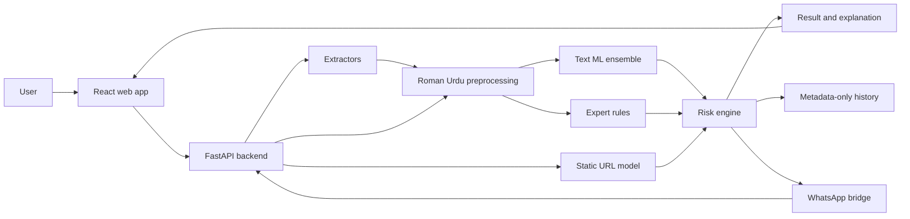

# Nigehbaan AI Project Explanation

## Purpose of this document

This document explains Nigehbaan AI from the beginning. It is written for a reader who may know very little about machine learning, expert systems, web applications, or WhatsApp integrations. It explains what problem the project solves, why each technology was selected, how the parts communicate, how the models were trained, what the user sees, and how to explain the system during a CT-361 viva.

## 1. What the project does

Nigehbaan AI is a privacy-aware system for detecting scam, phishing, and abusive messages written in Roman Urdu or mixed Roman Urdu and English.

The user can provide:

- typed message text;
- a URL;
- an image or screenshot;
- a PDF;
- an audio voice note; or
- a short video.

The system returns:

- a class: `normal`, `abusive`, or `scam`;
- class probabilities;
- a risk score from 0 to 1;
- a risk level: `low`, `medium`, or `high`;
- expert-rule identifiers that matched;
- a human-readable explanation;
- static URL findings when links are present; and
- extraction warnings for media inputs.

It is a decision-support tool. It warns a human; it does not delete messages, block accounts, or claim that a low-risk message is guaranteed safe.

## 2. Why this problem matters

Fraudulent messages commonly pretend to come from a bank, courier, government program, family member, job provider, or payment service. They may request an OTP, PIN, CNIC, password, or money. In Pakistan, these messages are often written in Roman Urdu, where one word can have many spellings, for example `nahi`, `nahin`, and `nhi`.

An English-only spam filter may miss these spelling variations. An Arabic-script Urdu model may not understand Latin-script Roman Urdu. Nigehbaan combines learned patterns with explicit safety rules so that it can both generalize from examples and explain important warning signs.

## 3. The complete system in one sentence

The system extracts text, normalizes it, runs a trained text model, fires expert rules, analyzes URLs using static features, combines the evidence into a risk score, and displays the result in a React web application or sends a privacy-safe WhatsApp alert.

## 4. High-level architecture



The FastAPI backend is the single source of truth. The frontend only displays backend results. The WhatsApp client forwards events and sends the alert text returned by the backend; it does not contain detection logic.

## 5. Technologies used and why

### Python 3.11 or compatible project environment

Python is used for the backend, machine-learning training, preprocessing, extraction, and tests. It has mature libraries for NLP, classical ML, data processing, and scientific evaluation.

### FastAPI

FastAPI exposes HTTP endpoints such as `/api/analyze`, `/api/analyze/url`, `/api/analyze/file`, `/api/metrics/models`, and WhatsApp endpoints. It was selected because it is fast, supports type-checked request and response models, automatically generates OpenAPI documentation, and works well with Pydantic.

### Pydantic

Pydantic defines the API contract. It validates incoming data and ensures that responses use the allowed labels and risk levels. This prevents the frontend and backend from silently disagreeing about field names or data types.

### scikit-learn

Scikit-learn provides TF-IDF vectorization, Logistic Regression, Naive Bayes, Linear SVM calibration, Random Forest, model pipelines, metrics, and cross-validation. Classical models are appropriate here because the dataset is moderate, explainability matters, and the university project should be reproducible on a CPU.

### pandas and NumPy

Pandas loads and combines tabular datasets. NumPy supports numerical calculations and feature arrays.

### SQLite

SQLite stores only high-risk event metadata such as time, modality, label, score, and rule IDs. It does not store message bodies, transcripts, uploaded files, URLs, phone numbers, or CNICs.

### React and TypeScript

React builds the interactive interface. TypeScript catches frontend mistakes before runtime. The app uses generated API types rather than manually duplicating backend contracts.

### Vite

Vite provides the frontend development server and production bundling. It gives fast reloads during development and creates optimized static files for deployment.

### TanStack Query

TanStack Query manages server data such as metrics, settings, and dashboard metadata. It handles loading and error states and avoids duplicating request state in every component.

### Recharts

Recharts displays model comparisons, confusion matrices, and dashboard trends so that results are understandable rather than only numerical.

### PyMuPDF, EasyOCR, faster-whisper, Pillow, and FFmpeg support

These libraries support PDF text extraction, OCR, speech-to-text, image handling, and audio/video conversion. They are loaded only when the relevant media modality is used.

### Node.js and whatsapp-web.js

The WhatsApp bridge runs as a separate Node service. The implemented transport uses WhatsApp Web through a dedicated account. It is kept separate from the Python backend so the detection engine remains reusable by the web app and simulator. A real account must be dedicated and consent-based.

## 6. Repository structure

```text
backend/
  app/
    routers/       HTTP validation and response handling
    services/      preprocessing, ML, rules, risk, media, history
    resources/     YAML rules, normalization maps, lexicons
  ml/              offline data preparation, training, evaluation
  models/          generated model artifacts and metrics
  tests/           unit, contract, integration, and safety tests
frontend/
  src/             React pages, components, API client, generated types
whatsapp/
  bridge.mjs       thin WhatsApp transport client
docs/
  TECH_DOC.md      technical specification
  FINAL_RESULTS.json frozen aggregate evaluation
  AIES_CCA.pdf     teacher CCA brief
  AIES_CCP.pdf     teacher CCP brief
report/
  Nigehbaan_AI_CCP_Report.md academic report
  figures/          generated methodology and result figures
  VIVA.md           viva preparation
```

## 7. End-to-end processing flow

### Text input

1. The user types or pastes a message.
2. The frontend sends it to FastAPI.
3. The backend validates the request.
4. The preprocessing service normalizes the input.
5. The text pipeline produces probabilities for the three classes.
6. The rule engine checks the original request context and normalized forms.
7. Extracted URLs are scored by the static URL model.
8. The risk engine combines the evidence.
9. The backend returns the result and explanation.
10. Only eligible high-risk metadata may be added to local history.

### URL input

URLs are analyzed statically. The system never visits, downloads, resolves, or executes a submitted URL. It calculates lexical features such as length, host structure, suspicious symbols, digits, hyphens, IP-host usage, HTTPS, shorteners, suspicious top-level domains, keywords, query count, and character entropy.

### File input

The file endpoint first checks size, MIME type, magic bytes, page/pixel limits, and video duration. It extracts text using the appropriate extractor. Temporary files and converted files are deleted in `finally` blocks. The extracted text then follows the same analysis pipeline as typed text.

## 8. Roman Urdu preprocessing

Preprocessing is important because Roman Urdu has inconsistent spelling and code mixing.

The main order is:

1. Unicode NFKC normalization.
2. Control-character removal.
3. Script detection for Urdu-script input.
4. URL extraction before masking.
5. Lowercasing.
6. Replacement of URLs, emails, phone numbers, and money values with safe tokens.
7. Emoji counting and replacement with `emojitoken`.
8. Repeated-character reduction, such as `yaaaar` to `yaar`.
9. Lexical normalization using `normalization_map.json`.
10. Punctuation cleanup while retaining useful exclamation and question counts.
11. Optional stopword handling based on validation results.

The model uses both word and character features. Word n-grams learn phrases such as `paisay bhejo`. Character n-grams help match spelling variants even when the complete word is different.

## 9. Machine-learning models

### Labels

The project uses exactly three labels:

- `normal`: ordinary or legitimate communication;
- `abusive`: offensive, profane, hateful, or harassing communication;
- `scam`: fraudulent, phishing, spam, or credential/payment deception.

Negative sentiment is not automatically mapped to abuse because sadness, complaints, and disappointment are not necessarily harassment.

### Baseline

The baseline is TF-IDF plus Multinomial Naive Bayes. It gives a simple reference point. Its validation macro-F1 is approximately 0.392, and its scam recall is very weak because the scam class is small and token independence is a poor assumption for these messages.

### Improved models

The project compares:

- Logistic Regression with balanced class weights;
- calibrated Linear SVM;
- balanced Random Forest; and
- a soft-voting ensemble of the strongest models.

The selected text ensemble combines Logistic Regression and calibrated SVM probabilities. Training uses fixed random state 42, stratified splits, deduplication before splitting, and validation/CV for selection. The frozen test set is evaluated once.

### Evaluation metrics

Macro-F1 is the main metric because it gives each class equal importance despite imbalance. Scam recall is also important because missing a scam can be costly. Precision matters for alerts because too many false alarms reduce trust. Confusion matrices show which classes are being confused.

The frozen text test result is approximately:

- ML macro-F1: 0.9216;
- ML accuracy: 0.9580;
- scam recall: 0.8763;
- hybrid macro-F1: 0.9140.

The hybrid score is slightly lower because safety overrides converted four abusive examples into scam predictions. The hybrid is retained for explicit policy enforcement and explanations, not because it wins every aggregate metric.

## 10. Expert system

An expert system represents human knowledge as rules. In this project, the knowledge base is stored in `backend/app/resources/rules.yaml` and the abuse lexicon resources. The inference engine is implemented in `expert_rules.py`.

Important rules include:

- R01: contains a link;
- R02: shortened or suspicious link;
- R03: urgency language;
- R04: prize or lottery language;
- R05: credential, OTP, PIN, or CNIC request;
- R06: payment-transfer request;
- R07: institutional impersonation;
- R08: threat of account blocking or legal action;
- R09: unrealistic earning or profit promise;
- R10: relative or number-change emergency scam; and
- R11: abusive-lexicon hit.

Rules use weights as heuristic certainty factors. Scam and abuse have separate axes. This prevents every warning from being treated as the same kind of evidence.

R05 includes request context and safety negation checks. For example, advice saying not to share an OTP should not be treated the same as a request to send an OTP.

## 11. Risk engine

The risk engine combines three sources:

```text
p_ml    = 1 - probability(normal)
r_rules = maximum scam or abuse rule score
r_url   = maximum phishing probability for extracted URLs
```

With a URL:

```text
risk = 0.50 * p_ml + 0.30 * r_rules + 0.20 * r_url
```

Without a URL:

```text
risk = 0.60 * p_ml + 0.40 * r_rules
```

Risk levels are:

- low: below 0.35;
- medium: 0.35 to below 0.70;
- high: 0.70 or above.

If a credential request and a link are both present, the risk has a minimum floor of 0.85. This is a policy safety rule rather than a claim that the ML probability itself is 0.85.

## 12. Explainability

The result lists fired rule IDs and descriptions. For the Logistic Regression component, positive TF-IDF terms can be shown as partial cues. Because the selected model is an ensemble, this is not a complete explanation of every character feature or SVM contribution. The interface clearly describes the explanation as partial and preliminary.

## 13. Multimodal processing

Audio is converted to a suitable mono format and passed to faster-whisper. Spoken Urdu often produces Urdu Arabic-script output, so Urdu rules and an approximate transliteration bridge are used before the Roman Urdu model.

Images use OCR. PDFs first use embedded text and can fall back to OCR. Videos process audio and selected frames. Limits prevent oversized or excessively long uploads from exhausting the service.

Media testing used synthetic files. It confirmed the extraction paths and safety limits, but it is not a claim of real-world Urdu speech accuracy. OCR can miss a URL, which is an extraction limitation rather than proof that the source is safe.

## 14. Frontend application

The React application has five main pages:

- Analyze: text, URL, and file analysis;
- Dashboard: high-risk metadata history and aggregates;
- Model Lab: validation model comparisons, confusion matrices, and ablations;
- Settings: thresholds, WhatsApp status, and simulator; and
- About and Ethics: privacy, limitations, and human responsibility.

The frontend does not call the backend from arbitrary components. Requests are centralized in `frontend/src/api.ts`. Generated OpenAPI types reduce contract drift.

Every data view handles loading, error, and empty states. Browser input is kept in component memory and is not placed in local storage or query keys.

## 15. WhatsApp integration

The bridge receives events from a consenting dedicated account and forwards them to the backend. The backend checks owner opt-in, guardian confirmation, deduplication, and rate limits. Sender identifiers are hashed with a salt.

Alerts contain only generic reason categories and a masked sender identifier. Guardian alerts never include message content. The Settings simulator exercises the same backend alert policy without sending real messages.

For this submission, live pairing and real guardian delivery are not claimed. A dedicated throwaway account and explicit guardian consent would be required for live testing.

## 16. Privacy and safety

The project deliberately avoids storing message bodies, transcripts, uploaded media, raw URLs, phone numbers, and CNICs. Temporary files are cleaned up. Abuse words are masked. URLs are never fetched. Alerts default to safe dry-run behavior unless the configured consent and delivery requirements are satisfied.

These choices are important because a security tool should not create a second privacy problem while trying to detect the first one.

## 17. Datasets and limitations

The project uses Roman Urdu language data, Roman Urdu abuse data, English SMS spam as a scam-pattern proxy, a custom synthetic Roman Urdu scam draft, and a phishing URL dataset.

The main limitations are:

- the custom scam labels are not independently human-reviewed;
- Cohen’s kappa is not available;
- the custom hold-out has only 16 rows;
- English SMS is not identical to Pakistani Roman Urdu fraud;
- URL metrics are affected by source-specific shortcuts;
- realistic Urdu speech quality has not been fully evaluated; and
- WhatsApp live delivery is not verified.

These limitations must be stated in the report and viva. Honest limitations strengthen the credibility of the project; hiding them would make the evaluation weaker.

## 18. How to run the project

From the repository root on Windows:

```powershell
powershell -ExecutionPolicy Bypass -File scripts/start-demo.ps1
```

Then open:

```text
http://localhost:5173/#/analyze
```

Backend tests:

```powershell
cd backend
venv\Scripts\python.exe -m pytest -q
```

Frontend checks:

```powershell
cd frontend
npm run typecheck
npm run lint
npm run build
```

Generate report figures without retraining:

```powershell
cd backend
venv\Scripts\python.exe -m ml.make_figures
```

## 19. Recommended viva explanation

Start with the problem and the pipeline: “We detect Roman Urdu scam and abuse using a trained text ensemble plus transparent expert rules. Text or extracted media enters FastAPI, preprocessing handles spelling variation, ML estimates class probabilities, rules capture high-value policy cues, the URL model analyzes links without visiting them, and the risk engine returns an explainable warning.”

Then explain why the hybrid exists: “ML gives coverage over noisy language. Rules give explicit domain knowledge, explanations, and safety floors such as OTP request plus link. The hybrid is not claimed to have higher macro-F1 on every frozen test mixture.”

If asked whether the project is production-ready, answer no. It is a course-complete local prototype with strong engineering controls but known data, URL robustness, Urdu ASR, and live WhatsApp limitations.

## 20. Important files to open in a viva

- API contract: `backend/app/schemas.py`;
- preprocessing: `backend/app/services/preprocess.py`;
- classifier: `backend/app/services/classifier.py`;
- expert rules: `backend/app/services/expert_rules.py` and `backend/app/resources/rules.yaml`;
- risk formula: `backend/app/services/risk_engine.py`;
- frontend API boundary: `frontend/src/api.ts`;
- final aggregate metrics: `docs/FINAL_RESULTS.json`;
- technical report: `report/Nigehbaan_AI_CCP_Report.md`; and
- viva answers: `report/VIVA.md`.

## Final summary

Nigehbaan AI is not just a text classifier. It is an end-to-end hybrid AI and expert-system application. It combines noisy-language preprocessing, supervised learning, explicit knowledge rules, static URL analysis, multimodal extraction, a typed API, a visual interface, privacy-preserving metadata, and a consent-aware alert pathway. Its strongest academic contribution is the combination of measurable ML experimentation with transparent expert reasoning. Its strongest viva answer is also its most honest one: the system is a reproducible university prototype, not a perfect production detector.
