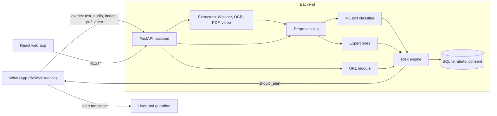

# Nigehbaan AI: Technical Documentation

**Multimodal Roman Urdu Scam & Abuse Detection with WhatsApp Guardian Alerts**
Course: CT-361 Artificial Intelligence & Expert Systems (NED University, CS&IT) · Deliverable: CCA / CCP
Status: v1.0 (planning baseline). Place this file at `docs/TECH_DOC.md` in the repo.

---

## 1. Purpose

A hybrid AI system (ML + rule-based expert system) that detects **scam/phishing** and **abusive** messages written in **Roman Urdu** (and code-mixed English). Input can be text, URLs, voice notes, images, PDFs and videos (all converted to text first). Output is a **risk score (low / medium / high)** with a human-readable explanation. Two delivery channels share one backend:

1. **Web app (React):** the user pastes text/URL or uploads a file and sees the result.
2. **WhatsApp integration (Baileys):** incoming messages on a consenting user's linked account are analyzed automatically; on **high risk** the user and their guardian get an alert.

### Goals
- Meet every CCA/CCP requirement (see section 2).
- Real, measurable ML work: baseline vs improved models, tuning, ensembling, ablations.
- A working end-to-end demo, with a safe fallback if WhatsApp is unavailable.

### Non-goals (do not build)
- Message content storage, user accounts/login system, payment, mobile app, fine-tuning big LLMs (XLM-R is an optional stretch only), moderation of other people's chats without consent.

---

## 2. Requirement Mapping (CCA / CCP)

| Course requirement | How Nigehbaan AI satisfies it |
|---|---|
| Real-world problem, clear I/O | Input: text / URL / file. Output: label (normal / abusive / scam), risk score, explanation |
| 2+ datasets or 1 large | 4 text sources + 1 URL dataset (section 5) |
| Pre-processing of noisy data | Roman Urdu normalization, dedupe, imbalance handling (section 6) |
| Diverse data types | Text, URL, audio, image, PDF, video |
| Baseline + improvement via multiple AI approaches | TF-IDF + Naive Bayes baseline; LR, SVM, RF, voting ensemble; expert rules; tuning (section 7) |
| Privacy / ethics (fairness, transparency, accountability) | No text storage, consent flow, explanations, bias checks (section 13) |
| Visualization / interface | React dashboard: analyzer, alerts, model lab (section 11) |
| Network dependency of real-time monitoring | WhatsApp needs internet; fallback simulator (section 12) |
| CCP only: 10+ page technical report with methodology diagram | Report outline in section 16 |

Note: the CCA brief lists code + visualization as deliverables; the CCP brief additionally requires the 10-page report.

---

## 3. System Architecture



**Pipeline for any input:** extract text (if not text) → preprocess → (ML probs ‖ rule flags ‖ URL score) → risk engine → response (+ alert decision for WhatsApp events).

**Design principle:** the backend is the single source of truth. The WhatsApp service is a thin client: it forwards events and sends whatever alert text the backend returns.

---

## 4. Tech Stack

| Layer | Choice |
|---|---|
| Backend | Python 3.11, FastAPI, Pydantic v2, Uvicorn, SQLAlchemy + SQLite |
| ML | scikit-learn, imbalanced-learn, pandas, numpy, joblib (optional: xgboost) |
| NLP extras | custom Roman Urdu normalizer, tldextract |
| Speech | faster-whisper (model `small`, int8 on CPU) |
| OCR | EasyOCR (`en`, `ur`); Tesseract as fallback |
| PDF / video | PyMuPDF; ffmpeg + opencv-python-headless |
| Frontend | React 18, Vite, TypeScript, Tailwind, React Router, Recharts, TanStack Query, openapi-typescript |
| WhatsApp | Node 20, `@whiskeysockets/baileys`, axios, pino |
| Tests | pytest, httpx; vitest (minimal) |

---

## 5. Repository Layout

```
nigehbaan-ai/
├── AGENTS.md                  # rules for AI coding agents (Cursor)
├── SKILLS.md                  # reusable step-by-step playbooks
├── docs/TECH_DOC.md           # this file
├── backend/
│   ├── app/
│   │   ├── main.py, config.py, schemas.py, db.py
│   │   ├── routers/           # health, analyze, alerts, consent, whatsapp, metrics
│   │   ├── services/          # preprocess, classifier, expert_rules, url_features,
│   │   │                      # risk_engine, extractors/{audio,image,pdf,video}.py, alert_policy
│   │   └── resources/         # rules.yaml, normalization_map.json, stopwords_ru.txt,
│   │                          # urgency/lexicons, urdu_script_lexicon.txt
│   ├── ml/                    # data_prep.py, train_text.py, train_url.py, evaluate.py
│   ├── data/raw, data/processed   # git-ignored (keep .gitkeep)
│   ├── models/                # text_clf.joblib, url_clf.joblib, metrics.json, label_map.json
│   └── tests/
├── frontend/                  # Vite + React + TS + Tailwind
├── whatsapp/                  # Baileys service (Node)
├── notebooks/                 # EDA and experiments
└── report/                    # figures, diagram, report draft
```

---

## 6. Data

### 6.1 Label schema (3 classes)
`normal`, `abusive` (offensive, profane, hate, harassment), `scam` (scam, phishing, spam with fraudulent intent).

### 6.2 Sources

| # | Dataset | Type | Used for | Mapping |
|---|---|---|---|---|
| 1 | UCI Roman Urdu Data Set (~20k sentences, sentiment) | Roman Urdu text | Everyday Roman Urdu language | Positive/Neutral → `normal`. **Negative is NOT auto-mapped to abusive** (negative ≠ abusive); exclude it from class labels or use only in an optional sentiment experiment |
| 2 | RUHSOLD, Roman Urdu hate/offensive speech (~10k tweets) | Roman Urdu text | Abusive class | Normal → `normal`; offensive/abusive/hate → `abusive` |
| 3 | SMS Spam Collection (UCI, ~5.5k) | English SMS | Scam patterns, cross-lingual augmentation experiment | spam → `scam`, ham → `normal` |
| 4 | **Custom Roman Urdu scam set** (we build it) | Roman Urdu text | The missing `scam` class + hard negatives | see 6.3 |
| 5 | Phishing URL dataset (PhishTank / Kaggle / UCI Phishing Websites) | URL / features | URL model | phishing → 1, benign → 0 |

Verify availability, license and exact label names of every dataset before use, then record them in `docs/DATASETS.md` (source link, date downloaded, size, class counts, license).

### 6.3 Custom scam set (critical, because no ready-made Roman Urdu scam data exists)
- Target: **400-600 scam** messages + **300+ hard-negative normal** messages (real-looking links, "urgent", delivery updates, bank notifications that are legitimate).
- Scam themes: prize/lottery ("inaam nikla"), bank/OTP/CNIC request, Easypaisa/JazzCash payment, BISP/Ehsaas/government aid, fake job/online earning, courier/parcel, loan, crypto/investment, WhatsApp group invite, "number change, paisay bhejo" relative impersonation.
- Create via templates + manual writing + LLM-assisted variation. **Every item must be manually reviewed.** Add columns: `text, label, theme, source (manual | llm_assisted | template), annotator`.
- Use spelling variation deliberately (acha/achha/accha, nahi/nahin/nhi, kia/kya) and code-mixing.
- Two team members label independently, then compute **Cohen's kappa** (report it). Resolve disagreements by discussion.
- Be honest in the report: this set is curated/synthetic and results on it are not the same as real-world prevalence.
- Never include real people's phone numbers, CNICs, or real account numbers. Use fake placeholders.

### 6.4 Splitting
- Merge to `data/processed/all.csv` with columns `text, label, source, lang_hint`.
- **Deduplicate first**, then stratified split **70 / 15 / 15** (train / val / test), `random_state=42`.
- Keep a separate **custom-scam hold-out** to report realistic scam performance.
- The test set is used **once** for final numbers.

---

## 7. Preprocessing (Roman Urdu text)

Order matters. Implement in `services/preprocess.py` as small, pure, unit-tested functions.

1. Unicode normalization (NFKC), strip control characters.
2. Detect **script**: if Urdu-script ratio > 0.3, route to the Urdu-script path (section 10.2).
3. Lowercase.
4. Replace entities with tokens: URLs → `urltoken` (also **extract and keep** the raw URLs for the URL module), phone numbers → `phonetoken`, money amounts (Rs, PKR, rupay, lakh) → `amounttoken`, emails → `emailtoken`.
5. Emoji → count feature + `emojitoken`.
6. Collapse repeated characters to max 2 ("yaaaar" → "yaar").
7. Lexical normalization via `normalization_map.json` (acha/achha/accha → `acha`, nahi/nahin/nhi → `nahi`, kia → `kya`, etc.). This map is a living file; grow it from error analysis.
8. Remove punctuation (keep `!` and `?` counts as features).
9. Optional stopword removal with custom `stopwords_ru.txt` (test with and without; keep whichever wins on validation).
10. Handcrafted features (for rules and as optional model input): length, uppercase ratio, `!` count, digit ratio, has-url, url count, emoji count.

Vectorization: **TF-IDF word 1-2-grams + char_wb 2-5-grams** (char n-grams absorb spelling variation).
Imbalance: `class_weight="balanced"` first; SMOTE only as an experiment, not default.

---

## 8. ML Models and Evaluation

### 8.1 Models
| Role | Model |
|---|---|
| Baseline | TF-IDF + MultinomialNB |
| Improved | Logistic Regression, LinearSVC (calibrated), Random Forest |
| Best | Soft-voting ensemble of the top models |
| Optional stretch | XLM-R fine-tune (only if time remains) |

Tuning: `RandomizedSearchCV` / `GridSearchCV`, stratified 5-fold on train, scoring = macro-F1. Log every run (params, scores) to `backend/models/experiments.csv`.

### 8.2 Metrics
Primary: **macro-F1**. Also per-class precision/recall/F1 (recall on `scam` matters most: a missed scam is costly), confusion matrix, ROC-AUC (one-vs-rest), inference latency.
Working targets (not promises): macro-F1 ≥ 0.80 on test; scam recall ≥ 0.85.

### 8.3 Ablations (these make the report strong)
1. Raw text vs normalized text.
2. Word n-grams vs char n-grams vs both.
3. With vs without stopword removal.
4. ML only vs rules only vs hybrid (full risk engine).
5. With vs without SMS Spam Collection augmentation.
6. Baseline vs each improved model vs ensemble.

### 8.4 Error analysis
Export top misclassified items per class (anonymized), categorize causes (spelling, sarcasm, code-mixing, short text), feed fixes back into the normalization map and rules.

### 8.5 Artifacts contract (backend ⇄ frontend)
Training writes, and the API/frontend read:
- `models/text_clf.joblib` (full sklearn Pipeline: vectorizer + classifier)
- `models/url_clf.joblib`
- `models/label_map.json`
- `models/metrics.json`:

```json
{
  "generated_at": "ISO-8601",
  "dataset": {"train": 0, "val": 0, "test": 0, "class_counts": {"normal": 0, "abusive": 0, "scam": 0}},
  "models": [
    {"name": "nb_baseline", "macro_f1": 0.0, "accuracy": 0.0,
     "per_class": {"normal": {"p": 0, "r": 0, "f1": 0}, "abusive": {}, "scam": {}},
     "confusion_matrix": [[0,0,0],[0,0,0],[0,0,0]], "latency_ms": 0.0}
  ],
  "ablations": [{"name": "raw_vs_normalized", "rows": []}],
  "best_model": "voting_ensemble"
}
```

---

## 9. Expert System (rules) and Risk Engine

### 9.1 Rules (`resources/rules.yaml`, fully configurable)
Each rule: `id, description, patterns (regex/keywords, Roman Urdu + English + Urdu script), weight`.

| ID | Rule | Example cues | Weight |
|---|---|---|---|
| R01 | Contains link | `http`, `www`, domain-like | 0.15 |
| R02 | Shortened / suspicious link | bit.ly, tinyurl, `.xyz/.top/.tk` | 0.20 |
| R03 | Urgency | foran, abhi, jaldi, urgent, last chance, 24 ghantay | 0.15 |
| R04 | Prize / lottery | inaam, jeet gaye, lottery, winner, mubarak ho | 0.30 |
| R05 | Credential request | OTP, PIN, CNIC, password, account number, code bhejein | 0.35 |
| R06 | Payment request | Easypaisa, JazzCash, advance, bank transfer, paisay bhejein | 0.25 |
| R07 | Impersonation | bank, BISP, Ehsaas, NADRA, courier, customer care | 0.20 |
| R08 | Threat | account block, band ho jayega, legal action, FIR | 0.20 |
| R09 | Too-good-to-be-true offer | ghar baithay kamayein, daily 5000, guaranteed profit | 0.25 |
| R10 | Unknown-number relative scam | number change, urgent paisay chahiye | 0.25 |
| R11 | Abusive lexicon hit | curated abusive word list | 0.30 (abuse axis) |

`rule_score = min(1, sum(weights of fired scam rules))`. Abuse rules feed the abuse axis. Keep the abusive lexicon in a separate file (`resources/abuse_lexicon.txt`) and do **not** print it in logs or the UI beyond masked flagged words (e.g., `g***`).

### 9.2 Risk engine (`services/risk_engine.py`)
```
p_ml    = 1 - P(normal)                       # from the ML classifier
r_rules = max(scam_rule_score, abuse_rule_score)
r_url   = max P(phishing) over extracted URLs  # omitted if no URL

with URL:    risk = 0.50*p_ml + 0.30*r_rules + 0.20*r_url
without URL: risk = 0.60*p_ml + 0.40*r_rules

overrides:   R05 (credential request) AND has-URL  -> risk = max(risk, 0.85)
levels:      low < 0.35 <= medium < 0.70 <= high
```
All weights and thresholds live in `config.py` / `.env` and are **tuned on the validation set** (report the chosen values). Final `label` = argmax of ML probs unless rules push risk to high with a positive scam axis at least as strong as the abuse axis, in which case label = `scam` (document this rule).

### 9.3 Explanation
Implemented: positive word TF-IDF times LR coefficient contributions for the predicted ML class, with VotingClassifier label decoding and lexicon masking. These are explicitly partial LR-component cues, not a full ensemble attribution. Character/SVM effects are not attributed.
Template-based and deterministic: list fired rules in plain language, top contributing n-grams (from LR coefficients or NB log-probs), and URL findings. Example:
> "High risk (0.87): asks for OTP, contains a shortened link, uses urgency words. Model also leans 'scam' (0.82)."

---

## 10. Multimodal and URL

### 10.1 URL module
Features: length, host length, dots, subdomain count, digits, hyphens, `@` present, IP-as-host, https, shortener, suspicious TLD, keyword hits (login, verify, secure, bank, update, prize), path length, query params, character entropy. Models: LR baseline → RF / GradientBoosting; report metrics like the text models. **Never fetch or visit the URL** in v1 (safety); analysis is static.

### 10.2 Extractors (`services/extractors/`)
| Input | Method | Notes |
|---|---|---|
| Audio (voice note, ogg/opus/mp3/wav) | ffmpeg → 16 kHz mono → faster-whisper (`language="ur"` or auto) | Whisper outputs **Urdu script** for spoken Urdu. Handling: (a) run rules with an Urdu-script lexicon, (b) best-effort transliteration to Roman Urdu via a mapping table, then ML. State this limitation in the report |
| Image / screenshot | EasyOCR (`en`, `ur`) | Roman Urdu screenshots are Latin, so `en` works well; preprocess (grayscale, resize) |
| PDF | PyMuPDF text; if a page has no text, render and OCR | cap pages (e.g., 20) |
| Video | ffmpeg audio → Whisper; keyframes every N s → OCR | cap duration (e.g., 60 s) and size (25 MB) |

All extractors return `extracted_text`, `confidence` (if available) and `warnings`. Enforce size and duration limits, validate MIME type, delete temp files immediately after processing.

---

## 11. Backend API (contract)

Base path `/api`. Pydantic models in `schemas.py` are the **single source of truth**; the frontend generates TS types from the OpenAPI spec.

### 11.1 Common result object
```json
{
  "modality": "text|url|audio|image|pdf|video",
  "extracted_text": "string|null",
  "label": "normal|abusive|scam",
  "probabilities": {"normal": 0.0, "abusive": 0.0, "scam": 0.0},
  "rule_flags": ["R04", "R05"],
  "rule_details": [{"id": "R05", "description": "Asks for OTP/CNIC", "weight": 0.35}],
  "url_findings": [{"url": "string", "phishing_prob": 0.0, "features": {}}],
  "risk_score": 0.0,
  "risk_level": "low|medium|high",
  "explanation": "string",
  "flagged_words": ["string"],
  "warnings": ["string"],
  "latency_ms": 0
}
```

### 11.2 Endpoints
| Method | Path | Purpose |
|---|---|---|
| GET | `/health` | liveness |
| POST | `/analyze/text` `{text}` | analyze text |
| POST | `/analyze/url` `{url}` | analyze one URL |
| POST | `/analyze/file` (multipart `file`) | auto-detect modality, extract, analyze |
| GET | `/metrics/models` | returns `metrics.json` for Model Lab |
| POST | `/whatsapp/event` (header `X-API-Key`) | WhatsApp service forwards an event; returns result + `should_alert`, `alert_user_text`, `alert_guardian_text` |
| GET | `/alerts?limit=&offset=` | alert history (no message text) |
| POST / GET | `/consent` | register / read consent state (user, guardian) |
| POST | `/simulate/whatsapp` | demo fallback: same as event, without WhatsApp |

Errors: consistent JSON `{error: {code, message}}`, proper status codes (400 validation, 413 too large, 415 unsupported type, 422 schema).

---

## 12. WhatsApp Integration

### 12.1 Flow
1. `whatsapp/` connects with Baileys (QR pairing, multi-file auth state in a git-ignored folder).
2. On `messages.upsert`: skip own messages, status broadcasts, and (by default) groups. Detect type: text, audio, image, document (PDF), video.
3. Text → `POST /api/whatsapp/event`; media → download buffer, send as multipart.
4. Backend returns result and alert decision. If `should_alert` (risk ≥ `ALERT_THRESHOLD`, default 0.70), the service sends:
   - **to the protected user:** warning + short reasons;
   - **to the guardian:** warning + masked sender + risk level + reason categories. **Never the message content.**
5. Backend stores an alert row (no text).

### 12.2 Alert policy (`services/alert_policy.py`)
- Only alert on **high** risk. Per-sender rate limit (e.g., max 3 alerts/hour) and dedupe of identical content hashes.
- `DRY_RUN=true` logs the alert instead of sending (default in dev).
- Guardian receives alerts only after **both parties consent** (consent flow below).

### 12.3 Consent (mandatory)
- Only the **linked account owner's own incoming messages** are analyzed, and only after they opt in (`/consent`).
- Guardian opts in by replying with a confirmation code sent to them; they can reply `STOP` at any time to unsubscribe.
- Show a consent screen in the React Settings page. Document this in the report (ethics).

### 12.4 Storage (SQLite, privacy by design)
`alerts(id, ts, sender_hash, modality, label, risk_score, risk_level, rule_ids)` and `consent(user_id, guardian_jid, status, ts)`. `sender_hash = sha256(SALT + sender_jid)`. **No message text, no media, no transcripts are stored or logged.**

### 12.5 Risks
- Baileys is **unofficial** and can violate WhatsApp ToS; accounts can be banned. Use a **dedicated demo number**, never a personal/business number.
- Fallbacks: `/simulate/whatsapp` endpoint + UI button for demos; Telegram bot as an alternative channel; WhatsApp Cloud API is the official (heavier) path.

---

## 13. Ethics, Privacy, Fairness

- **Privacy:** no text/media persistence; hashed sender IDs; temp files deleted; secrets in `.env`; consent required.
- **Transparency:** every result has an explanation (fired rules, top terms).
- **Accountability:** alert history with rule IDs; thresholds documented; a human always makes the final call (the system warns, never blocks or deletes).
- **Fairness:** evaluate error rates across dialect/spelling variants and across sources; avoid flagging identity terms as abusive (test with neutral sentences that mention religion, ethnicity, gender); document limitations.
- **False positives:** hard-negative set, medium level without guardian alert, threshold tuning.
- **Data handling:** no real personal data in datasets; custom set uses placeholders.

---

## 14. Frontend (React + TS + Tailwind)

| Page | Contents |
|---|---|
| **Analyze** | Tabs: Text / URL / File (drag-drop). Result card: label badge, risk meter (green / amber / red), rule chips, highlighted flagged words, explanation, extracted-text preview with a "hide" toggle, latency |
| **Dashboard** | Alert history table, risk-level distribution, modality breakdown, timeline (Recharts) |
| **Model Lab** | Model comparison table and macro-F1 bars (from `/metrics/models`), confusion matrix heatmap, ablation tables |
| **Settings** | Consent, guardian number, threshold display, dry-run indicator, simulate-WhatsApp button |
| **About / Ethics** | Short privacy and limitations statement |

UI quality bar: responsive, loading and error states everywhere, accessible contrast, no layout jumps. API access only through `src/api.ts` with generated types.

---

## 15. Work Plan, Roles, Milestones

Two tracks that meet at the contracts in sections 8.5 and 11.

**Track A: Data & ML** (data prep, custom scam set, preprocessing, models, rules, URL model, metrics.json)
**Track B: Platform** (scaffold, API, risk engine integration, extractors, frontend, WhatsApp, DB)

| M | Milestone | Acceptance criteria |
|---|---|---|
| M0 | Scaffold | Backend + frontend run; `/health`, stub `/analyze/text`, UI calls it |
| M1 | Data ready | Datasets documented; `all.csv` built; deduped; splits saved; class counts reported |
| M2 | Preprocessing | Pipeline + unit tests; before/after examples; normalization map v1 |
| M3 | Baseline | NB baseline trained; metrics.json v0; confusion matrix |
| M4 | Improved models | LR/SVM/RF tuned; ensemble; ablations; `text_clf.joblib` loaded by API |
| M5 | Rules + risk engine | rules.yaml, tests per rule, risk formula tuned on val; explanations |
| M6 | URL module | Features, model, endpoint, tests |
| M7 | Multimodal | Audio/image/PDF/video extractors + `/analyze/file` with limits |
| M8 | Frontend complete | All 5 pages; Model Lab reads real metrics |
| M9 | WhatsApp | Baileys service, consent, alert policy, dry-run, real alert demo |
| M10 | Polish and report | Demo script, screenshots, report, final test run |

Rule of thumb: finish M0-M6 before spending time on M7-M9. The project must already be complete without WhatsApp.

### Git workflow
`main` (stable) ← `dev` ← feature branches (`feat/...`, `fix/...`). Small PRs, the other partner reviews. Conventional commits (`feat:`, `fix:`, `docs:`, `test:`, `chore:`). Never commit data, models, `.env`, or WhatsApp auth state.

---

## 16. Technical Report Outline (CCP, 10+ pages)

| Section | Pages |
|---|---|
| 1. Introduction, problem, significance | 1 |
| 2. Related work and datasets (with table) | 1.5 |
| 3. Methodology + architecture diagram | 1.5 |
| 4. Preprocessing (before/after examples) | 1 |
| 5. Models and expert system (baseline → improved → hybrid) | 1.5 |
| 6. Results (tables, confusion matrices, ablations, error analysis) | 2 |
| 7. UI and WhatsApp integration (screenshots) | 1 |
| 8. Ethics, privacy, limitations | 0.5 |
| 9. Challenges | 1 |
| 10. Conclusion and future work, references | 0.5 |

---

## 17. Testing Strategy

- **Unit:** each preprocessing function; each rule (one positive and one negative example); URL features; risk engine thresholds and overrides; alert policy (rate limit, consent).
- **API contract:** response matches `schemas.py` for every endpoint; error cases.
- **ML smoke test:** loads artifact, predicts a known scam and a known normal sentence.
- **Frontend:** type-check, lint, build must pass; manual QA checklist for each page.
- **End-to-end:** scripted demo (paste scam text, upload voice note, simulate WhatsApp event, see alert in dashboard).
- Fixed seeds for reproducibility.

---

## 18. Configuration (`backend/.env.example`)

```
API_KEY=change-me
ALLOWED_ORIGINS=http://localhost:5173
DB_URL=sqlite:///./nigehbaan.db
ALERT_THRESHOLD=0.70
MEDIUM_THRESHOLD=0.35
DRY_RUN=true
SALT=change-me
WHISPER_MODEL=small
MAX_UPLOAD_MB=25
MAX_VIDEO_SECONDS=60
```

---

## 19. Risks and Mitigations

| Risk | Impact | Mitigation |
|---|---|---|
| No labeled Roman Urdu scam data | Weak scam class | Custom set + hard negatives, SMS spam augmentation, rules as safety net |
| Label noise from mapping sentiment to classes | Bad model | Do not map negative → abusive; document mappings |
| Whisper outputs Urdu script | Voice path weaker | Urdu-script lexicon for rules + transliteration; state limitation |
| Baileys ban / instability | Demo failure | Dedicated number, `DRY_RUN`, simulator, Telegram fallback |
| Heavy models on a laptop | Slow demo | Whisper `small` int8, size/duration caps, lazy-load models |
| False alerts to guardian | Trust loss | High threshold, rate limit, consent, explanation |
| Time overrun | Incomplete project | Milestone order M0-M6 first; multimodal and WhatsApp are layers |

---

## 20. Open Questions (decide early)
1. CCA or CCP (decides if the 10-page report is required)?
2. Submission deadline and demo format (live vs video)?
3. Who owns Track A and who owns Track B?
4. Which number will be the dedicated WhatsApp demo account?

### Validation-only baseline artifacts
The M3 trainer writes run-local metrics.json with the section 8.5 model fields,
plus evaluation_split="validation". dataset.test is null when unknown because
the trainer never opens test.csv; class_counts describes the training split.
No test metric is implied. Each fresh run directory includes experiments.csv,
label_map.json (display labels and sklearn probability order), run_metadata.json
(input/source SHA256 and software versions), validation_metrics.json and the
complete nb_baseline.joblib pipeline. These are not automatically promoted to
models/text_clf.joblib or served by the API. Review status is explicitly unverified.

### Trained text model integration
`/api/analyze/text` now uses the local promoted preliminary LR/SVM ensemble.
Its response schema is unchanged. The explanation identifies its human-unverified
status. Raw input passes through the frozen training-input sanitizer and saved
pipeline; rule processing retains the existing cleaned-text/URL path.
Missing, invalid or fingerprint-mismatched model artifacts return HTTP 503 with
`detail: Text model unavailable. Please try again later.` Input reduced to empty
text returns HTTP 422. No heuristic text fallback is silently substituted.
`/api/analyze/url` remains an untrained heuristic until M6; its explanation states this.
`backend/models/text_clf.manifest.json` records artifact fingerprint/provenance.
Only trusted local artifacts are supported; fingerprints detect accidental changes,
not malicious replacement of both model and manifest. Restart API to load a newly
promoted artifact, since successful model loads are cached.

### M5 implementation clarification
Separate axes prevent abuse-driven high risk with incidental scam cues from overriding the abuse label. See docs/RULES_RISK.md for the measured validation fix cycle. Before M6 supplies a trained URL probability, use no-URL fusion and disclose this fallback. Threshold sweep is diagnostic; defaults remain deployed, alert-severity calibration and n-gram attribution are pending. API rule_flags contain R01-R11 IDs; flagged_words contains only masked abuse matches. No response schema fields changed.

### M6 URL implementation / contract clarification
UCI PhiUSIIL is the selected public URL source within section 6.2's UCI URL category.
See docs/URL_MODEL.md and URL_DATASET_INVENTORY.json for provenance, pinned bytes, label inversion,
canonical deduplication, fixed stratified splits, validation metrics and source limitations.
Only raw URL/label columns are read in memory. No webpage-derived columns or network lookups are used.
The saved sklearn pipeline contains stateless numeric URL extraction plus the selected classifier.
Text with URLs uses max P(phishing) in the existing 0.50/0.30/0.20 fusion. A missing/corrupt URL model
leaves text analysis available with an explicit no-URL-model fallback explanation.
Standalone URL analysis has no independent text model evidence: risk_score=P(phishing),
probabilities={normal:1-P(phishing), abusive:0, scam:P(phishing)}; existing risk thresholds apply.
This avoids double-counting the same URL evidence. Its label is the probability argmax.
Invalid HTTP(S) URL -> 422; missing/corrupt model -> 503. No heuristic probabilities are substituted.
url_features now returns only numeric/boolean lexical cues; raw URL/host/credentials are not echoed.
Response schema fields and TypeScript types are unchanged. metrics.json adds url_models (binary
benign/phishing class order) and best_url_model, separate from the three-class text models.
Historical M5 validation did not use the URL model; do not describe that score as M6 full-text validation.

### M8 web interface and public contracts (2026-11-11)
Five hash-routed pages: Analyze, Dashboard, Model Lab, Settings, About/Ethics.
GET /api/metrics/models returns the allowlisted aggregate ModelMetrics schema; text and URL
class sets remain separate. Missing/malformed report returns 503. Unknown metadata is not exposed.
GET /api/alerts?limit=20&offset=0 returns AlertHistory: items, total, limit, offset,
by_modality and by_day (UTC date keys). Limit 1..100; offset >=0; invalid values return 422.
Rows contain only id, ts, modality, label, risk_level, risk_score, rule_ids. Only high-risk web
analyses are retained in ignored backend/data/runtime/alerts.sqlite3. This is local result
history, not delivered alerts. Low/medium results are not saved, so counts are not overall
analysis volume or accuracy. No text, URLs, phone numbers or sender identifiers are accepted
by the persistence service. Analysis succeeds with an explanation if history writing fails.
GET /api/settings returns display-only medium/high thresholds, credential_url_floor,
dry_run, whatsapp_available=false and consent_available=false. No secrets or contacts.
Guardian setup/consent/simulation stays unavailable until M9; file analysis stays unavailable
until M7. Settings intentionally does not collect a phone number or fake an enabled connection.
Public schemas live in app/dashboard_schemas.py; frontend types generated from FastAPI OpenAPI
with npm run gen:types. API requests centralized in src/api.ts; TanStack Query caches only
read-only metadata. Analysis inputs/results use local component state and are never put in
query keys, localStorage or sessionStorage. Charts use Recharts and generated measured data.

### M7 implementation contract (2026-11-11)
POST /api/analyze/file accepts multipart UploadFile `file`, verifies magic bytes/MIME,
and returns FileAnalyzeResponse: all AnalyzeResponse fields plus modality (image/pdf/audio/video),
extracted_text (masked 5,000-character preview), optional extraction_confidence, warnings.
Response content is in memory only. No transcripts or filenames enter history or logs.
Public settings add max_upload_mb, max_pdf_pages and max_media_seconds. File UI reads these values.
30,000-character extraction limit rejects larger content rather than silently analyzing a prefix.
Errors: 413 limits, 415 unsupported/mismatch, 422 unreadable/no text, 429 media busy, 503 missing model.
See docs/MEDIA.md for processing, limits, setup, privacy and measured extraction limitations.

### M9 local bridge contract

Authenticated GET and POST /api/consent use a keyed guardian digest. POST /api/whatsapp/event accepts text and keyed sender/guardian digests. POST /api/whatsapp/media accepts the same digests and a bounded multipart media upload. Both return Decision: reason, should_alert, dry_run, risk_level, rule_ids, and optional generic alert text. POST /api/simulate/whatsapp runs a built-in example with no persistence or outbound delivery. The local bridge binds analysis to an opted-in dedicated account and accepts a time-limited confirmation only from the configured guardian. STOP revokes consent. See whatsapp/README.md.
