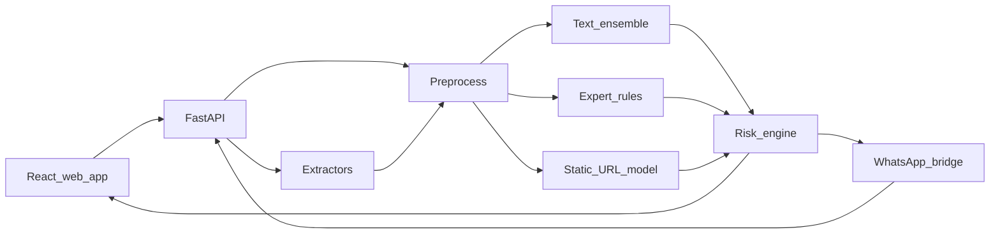

# Nigehbaan AI: what it is, gaps, and tomorrow’s finish plan

The original teacher files are now present as [docs/AIES_CCA.pdf](AIES_CCA.pdf) and [docs/AIES_CCP.pdf](AIES_CCP.pdf). Their wording has been checked against the project mapping and report.

## What the project is

Nigehbaan AI is a **Roman Urdu scam/phishing and abuse detector** for CT-361 (AI & Expert Systems).

**Inputs:** pasted text, a URL, or a file (image / PDF / audio / video converted to text).  
**Outputs:** class `normal | abusive | scam`, risk `low | medium | high`, fired expert-rule IDs, masked flagged words, and a short explanation.  
**Delivery:** React web app plus an optional WhatsApp guardian-alert path. The backend is the only place detection happens.

**Hybrid design (this is the expert-systems mark):**

- **ML:** TF-IDF (word 1–2 + char 2–5) → Naive Bayes baseline → LR / calibrated SVM / RF → **soft-voting LR+SVM** ([docs/MODEL_COMPARISON.md](docs/MODEL_COMPARISON.md)).
- **Knowledge base:** [backend/app/resources/rules.yaml](backend/app/resources/rules.yaml) R01–R11 (link, shortener, urgency, prize, OTP/CNIC, payment, impersonation, threat, get-rich, relative-impersonation, abuse lexicon).
- **Risk formula** ([docs/TECH_DOC.md](docs/TECH_DOC.md) §9.2): with URL `0.50 P(not-normal) + 0.30 max(scam,abuse rules) + 0.20 P(phish)`; without URL `0.60 / 0.40`. Floor 0.85 if credential request **and** URL. High + scam-axis ≥ abuse-axis can override label to `scam`.

**Privacy (ethics marks):** no message text stored; dashboard keeps high-risk **metadata only**; URLs are never fetched; abuse words masked.

## CCA / CCP checklist vs this repo

| Teacher requirement (TECH_DOC §2) | Status |
|---|---|
| Real-world problem, clear I/O | Met: Analyze page + API contract in [backend/app/schemas.py](backend/app/schemas.py) |
| 2+ datasets or 1 large | Met in pipeline design: UCI Roman Urdu, RUHSOLD, SMS Spam, custom scam, UCI PhiUSIIL URLs. **Honesty gap:** custom labels never human-reviewed |
| Pre-processing of noisy data | Met: [backend/app/services/preprocess.py](backend/app/services/preprocess.py) |
| Diverse data types | Met: text, URL, audio, image, PDF, video ([docs/MEDIA.md](docs/MEDIA.md)) |
| Baseline + multiple AI approaches | Met: NB 0.39 val → ensemble 0.94 val; rules; URL GB |
| Privacy / ethics | Met in design + About page; kappa / fairness-by-dialect not measured |
| Visualization / interface | Met: Analyze, Dashboard, Model Lab, Settings, About |
| Network / real-time monitoring | **Partial:** WhatsApp bridge exists ([whatsapp/](whatsapp/)) but **no live paired account**; Settings has a simulator |
| CCP 10+ page report + methodology diagram | **Implemented in Markdown**, with generated figures and methodology diagram in [report/](../report/). Final PDF/page-count verification remains |

**Implementation is largely M0–M9.** The academic wrapper now exists: report, figures, kappa-status disclosure, honest limitations, demo script, and viva sheet. Remaining work is final rendering/screenshots and optional genuine annotation review.

## Honest numbers (use these; do not type new ones)

From [docs/FINAL_RESULTS.json](docs/FINAL_RESULTS.json) and [docs/DEMO_REPORT.md](docs/DEMO_REPORT.md):

- Text test ML macro-F1 **0.922**, hybrid **0.914** (hybrid slightly **worse** on this mixture). Scam recall **0.876** (85/97).
- Custom hold-out: **16 rows**, hybrid F1 **0.79**. Spec wanted 400–600 scam + 300 hard negatives.
- URL test macro-F1 **0.996** — **not** a real-world claim. Benign training URLs are almost all `www` + HTTPS + root path; `example.com` scores high. Robustness candidates were **rejected** (recall gate).
- NB baseline val macro-F1 **0.392** vs ensemble **0.937**: viva will ask why (class imbalance ~16.8k/3.3k/454, NB independence, char n-grams).
- Rules-only val scam recall **0.05** ([docs/RULES_RISK.md](docs/RULES_RISK.md)): rules are a safety net, not the classifier.

## What will actually lose marks (priority)

1. **Report rendering/page count** — the CCP report exists in Markdown and DOCX, but final visual rendering and 10+ page verification remain outstanding. CCA also needs a rehearsed demo narrative.
2. **Unreviewed custom scam data / no Cohen’s kappa** — spec and [docs/DATA_REVIEW.md](docs/DATA_REVIEW.md) require two annotators. Do **not** invent kappa. Either review a 100-item sample tonight or report “preliminary, human-unverified” everywhere.
3. **URL false positives in a live demo** — examiners paste `https://example.com` or JazzCash-looking HTTPS links. Prepare a scripted URL set; do not whitelist domains in code to hide the bias.
4. **WhatsApp “real-time monitoring”** — the Baileys bridge is implemented, but live pairing and delivery were not verified. Use the simulator unless a dedicated demo account and recipient agreement are available.
5. **Expert-system story is thin if you only show ML F1** — hybrid does not beat ML on the frozen test set. You must explain **why rules still belong** (OTP+URL floor, explainability, low-resource scam templates).
6. **Imbalance / proxy labels** — English SMS spam ≠ Roman Urdu scam; UCI negative sentiment was correctly **not** mapped to abusive.
7. **Media limits** — OCR missed URLs in PNG/video; speech fixture is English; Urdu ASR is a known limitation.

## Do not spend time on

- Retraining text or URL models, consuming test data again, promoting failed `url_robust_*` runs.
- Building 800 new reviewed scam messages (unrealistic overnight).
- XLM-R, Telegram, notebooks, login/auth, cloud deploy.
- Fake kappa or fake WhatsApp “connected” state.

## Recommended final verification (implementation freeze + academic deliverables)

### A. Demo that cannot collapse (1–2 hours)

- Start with [scripts/start-demo.ps1](scripts/start-demo.ps1); follow [docs/DEMO.md](docs/DEMO.md).
- Script 6 viva cases: (1) Roman Urdu OTP+link → high/scam + R05; (2) safety sentence “OTP share na karein” → should **not** fire R05; (3) abuse with masked words; (4) PDF upload; (5) **known-phishing-looking** static URL vs **known-biased** benign URL, explaining the bias; (6) Settings → Simulate WhatsApp (no content in alert).
- Screenshots into `report/figures/` (Analyze scam/normal, Dashboard, Model Lab, Settings simulator). Blur nothing that is already synthetic; never capture real numbers.

### B. CCP report (rendering and verification)

`report/Nigehbaan_AI_CCP_Report.md` and the generated DOCX already exist. Render the DOCX/PDF locally and confirm the page count against TECH_DOC §16. **Every table must remain copied from generated JSON/MD**, not invented.

| Section | Source of truth |
|---|---|
| Problem / I/O | TECH_DOC §1 |
| Datasets table | [docs/DATASETS.md](docs/DATASETS.md), [docs/DATASET_INVENTORY.json](docs/DATASET_INVENTORY.json), FINAL_RESULTS split counts |
| Methodology diagram | TECH_DOC §3 mermaid → PNG |
| Preprocessing before/after | [docs/PREPROCESS_EXAMPLES.json](docs/PREPROCESS_EXAMPLES.json) — synthetic only |
| Models + expert system | MODEL_COMPARISON, RULES_RISK, risk formula |
| Results | FINAL_RESULTS, ABLATIONS, URL_MODEL, URL_ROBUSTNESS |
| UI / WhatsApp | screenshots + honest “implemented, not live-paired” |
| Ethics / limitations | TECH_DOC §13 + DEMO_REPORT remaining work |
| Challenges | custom-data gap, URL confounding, OCR, WhatsApp ToS |
| Future work | reviewed labels, independent URLs, Urdu ASR, official Cloud API |

Add a short **`ml/make_figures.py`** only if needed: bar charts and confusion matrices from `docs/FINAL_RESULTS.json` / `backend/models/metrics.json` into `report/figures/`. No new metrics.

### C. Optional human review (only if two people can sit tonight)

100-item independent sample from the existing review pack → kappa via `python -m ml.custom_dataset promote` **only if** both sheets are real. Do not auto-label. If not possible, keep “preliminary_human_unverified” in the report.

### D. Viva pack (must exist as a one-pager you can memorize)

`report/VIVA.md`: rehearse the questions mapped to **course theory**:

- Expert system vs ML vs hybrid; knowledge base vs inference engine; certainty/weights vs probabilities.
- Why TF-IDF + char n-grams for Roman Urdu spelling.
- Why not map sentiment-negative → abusive.
- Train/val/test, seed 42, dedupe-before-split, one-shot test.
- Class imbalance and `class_weight="balanced"`.
- Precision vs recall for scams (cost of miss).
- Why hybrid F1 can drop (4 abuse→scam overrides on test).
- Why URL 0.996 is leakage/confounding, not magic.
- Why URLs are never fetched (safety + ethics).
- Consent, guardian never sees content, hashed JIDs.
- Environment-based guardian authorization; off-app informed agreement; no in-chat STOP flow.
- Whisper Urdu-script → transliteration limitation.

## Current finish state

The environment and submission artifacts have been verified: backend tests pass, frontend typecheck/lint/build pass, and eight report figures have been generated. Do not retrain or consume the frozen test split again.

Remaining before submission:

1. Render the report through a local PDF/DOCX toolchain and confirm it is at least 10 pages.
2. Capture synthetic screenshots for the demo/report.
3. Keep the custom-label and no-kappa limitation explicit unless two real annotators complete a review.
4. Rehearse [report/DEMO_SCRIPT.md](../report/DEMO_SCRIPT.md) and [report/VIVA.md](../report/VIVA.md).
